# Immergas Dominus

<p align="center">
  
</p>

<p align="center">
  <a href="https://github.com/hacs/integration"></a>
  
  
  <a href="https://github.com/jotuera/immergas-dominus/blob/main/LICENSE"></a>
  <a href="https://buymeacoffee.com/jotuera"></a>
</p>

**🇬🇧 English** · [🇵🇱 Polski](https://github.com/jotuera/immergas-dominus/blob/main/README.pl.md)

Author: **JoTu** ([github.com/jotuera](https://github.com/jotuera))

Home Assistant custom integration for **local** control of an Immergas boiler through
the **Dominus** Wi-Fi module — no cloud, no MQTT. Home Assistant talks directly to the
Dominus module over local TCP (default port `2000`) using the module MAC and password.

> **Tested on Immergas Magis Combo, Magis Pro and Trio Hydro Hybrid 8** (the `MPROCOMBOV2`
> Dominus configuration). See [Supported models](#supported-models) for the full list.

> **Compatibility — two protocols.** Magis Combo / Pro (`*_MBUS_*` configs) use the
> 7-byte **Modbus** protocol — fully supported. Boilers whose Dominus config has no
> `modbus` flag — e.g. **VICTRIX ZEUS / AVIO**, STAR — use a 6-byte **OpenTherm**
> protocol; since 0.4.0 there is an **experimental OpenTherm mode** (pick it in the config
> flow). **Reading is verified on a VICTRIX ZEUS 25 ErP**; since 0.4.1 it also exposes
> **experimental writes** (CH / DHW setpoint, mode). The **CH setpoint write is confirmed** on a
> VICTRIX ZEUS 25 ErP since 1.5.6. See issue [#2](https://github.com/jotuera/immergas-dominus/issues/2).
>
> **With a CAR V2 (Amico V2) remote connected to the boiler**, the remote is in charge: its dial owns the
> **DHW setpoint** (Home Assistant shows it but cannot change it — neither can the official app) and it
> sets the heating curve and weekly schedule. The **max CH setpoint** can still be written. Disconnecting
> the CAR V2 makes the boiler report **E031** (lost communication with the CARV2) and ignore commands
> until that fault is cleared. The Dominus has no weekly heating schedule for OpenTherm boilers — without a
> CAR V2 the schedule has to live in Home Assistant.

> [!IMPORTANT]
> ### ⚠️ One connection at a time
> **The Dominus module accepts only ONE local connection at a time.** Home Assistant, the official
> **Dominus app** on your phone and any other tool talking to port `2000` all share this **single slot** —
> whoever holds it, blocks the others.
>
> - **Modbus mode** (Magis Combo / Pro): Home Assistant opens a short connection for each read cycle
>   (every 45 s) and closes it right away. The app can connect in between, but **while the app is open
>   and connected, Home Assistant reads can time out** and entities may go *unavailable* for a moment.
> - **OpenTherm mode** (VICTRIX and others): since 1.5.3 Home Assistant releases the session for ~20 s after
>   every polling cycle so the app can get in.
> - **Changing settings from Home Assistant:** close the Dominus app on the phone first — **force-close it,
>   do not just send it to the background**. An open app competes for the slot and the module drops the
>   other connection (`Connection reset by peer`).
> - **Never point two integrations or Home Assistant instances at the same module** (e.g. this integration
>   and a Dominus gateway add-on) — they will keep kicking each other off.

The interface is **English by default**, with a full **Polish** translation. The
integration version and author are also shown on each Dominus device page in Home
Assistant (the *Firmware* field, e.g. `0.3.0 — JoTu`).

## Features

- Local TCP connection, config flow (host/IP, port, Dominus MAC, Dominus password).
- No cloud dependency, no MQTT, no sniffer, no debug/raw-PDU entities.
- Last-known-good caching and dynamic polling — only PDUs of **enabled** entities are read.

### Main device

- Sensors: outdoor temperature (`3002`, `0xFF` = no probe), DHW tank temperature (`3016`).
- Operation mode select (`2000`): Standby / Summer / Cooling / Winter.
- DHW target (`2095`) and DHW thermostat.
- **DHW Comfort / Eco**: `DHW Comfort target` / `DHW Eco target` (default 50 / 45 °C) and the switch
  `DHW Comfort-Eco by schedule`. When on, the DHW target follows the DHW schedule (weekday `2490`–`2496`
  → Cal 1–4, `2310`–`2347`): Comfort inside the ranges, Eco outside; works with the zone 1 program in
  Manual too. `DHW phase` shows the current phase.
- **Boiler fault reporting** (like the Dominus app): fault code (`2100`), fault description
  (the project's own texts, 113 codes, in the Home Assistant language), `Boiler fault`
  (binary, *problem*) and `Reset available` (binary, `2101` bit 1).

### Zone 1 (and disabled-by-default Zone 2 / Zone 3)

- Room temperature, heating target, heating curve offset (U03), comfort/eco heat & cool,
  humidity and flow setpoints (sliders), plus a heating thermostat.
- Per-zone registers are offset by `+10` per zone (Zone 1 `2011/2015/2210…`,
  Zone 2 `2021/2025/2220…`, Zone 3 `2031/2035/2230…`). Zone 2/3 devices are disabled by
  default; enable the device to bring all its entities online.

### Heating schedule (disabled by default)

- 4 shared day profiles (Cal 1–4) × 4 comfort periods, each a start/end `time`
  (`2310`–`2347`, high byte = hour, low byte = minute; `24:00` shown as `23:59`).
- Weekday → profile assignment for Zone 1 (`2410`–`2416`), plus a
  **Set the same profile for all days** shortcut.

## Dashboard

The integration brings its own dashboard cards (the same cards as the
[IMMERGAS Modbus BMS NASA OpenTherm HUB](https://github.com/jotuera/immergas-modbus-bms-nasa-opentherm-hub), in a reduced view). Nothing
else to install: create a new dashboard (*Settings → Dashboards → Add dashboard*), open it, *⋮ → Edit dashboard →
⋮ → Raw configuration editor* and enter

```yaml
strategy:
  type: custom:immergas-dominus
```

- **Now** – what the boiler is asked for (heating / hot water), mode, program phase, CH and DHW setpoints, outdoor,
  zone 1 and DHW cylinder temperatures, active fault.
- **Setpoints** – zone 1 and DHW with −/+ and the Comfort / Eco profiles.
- **Operating mode** – Standby / Summer / Winter / Cooling (tap twice), zone 1 program phase, zone 1 settings
  (curve offset U03, the Comfort / Eco pair of the other mode, flow and humidity setpoints), DHW Comfort / Eco by the
  schedule.
- **Schedule** – the four calendars and the weekdays for CH and DHW. The calendar hours need the *Heating schedule*
  device (disabled by default); the card says so when it is off.
- **Connectivity** – the Dominus module (last successful read, failed polls) and the boiler behind it.
- **Settings** – vacation mode, automatic Summer / Winter, alert thresholds and the language of the fault description.
- **Calibration** – the heating curve offset (U03) with a recommendation from the room deviation and a **Set** button,
  cycling, DHW cycles per day, the Comfort–Eco gap and heating hours per degree day.
- **Charts** – day: zone 1 room / target / outdoor with the program phases and heating demand, DHW cylinder with the
  DHW requests; week / month: hours of CH and DHW demand per day and the mean outdoor temperature.

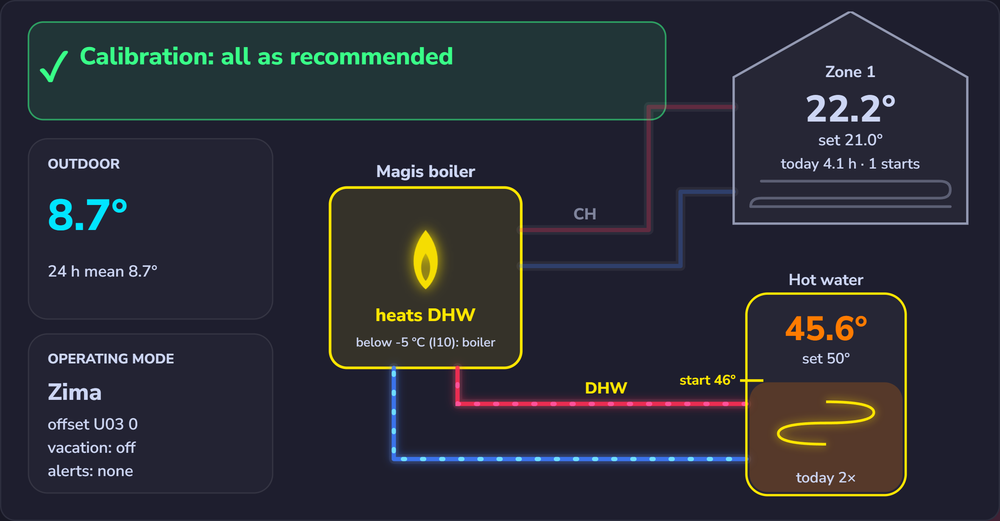

| | |
|---|---|
| 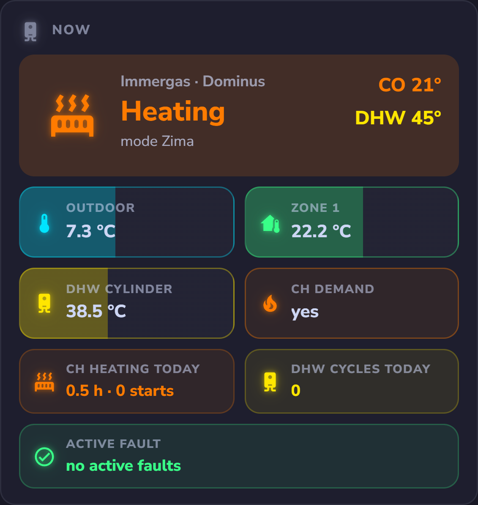 | 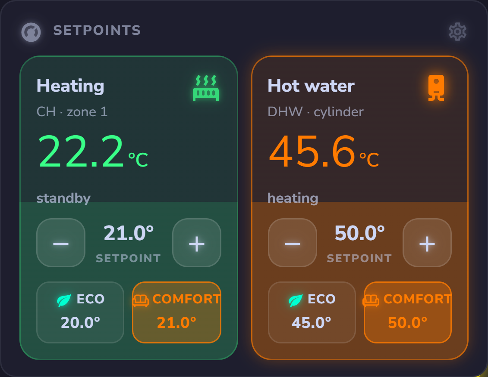 |
| 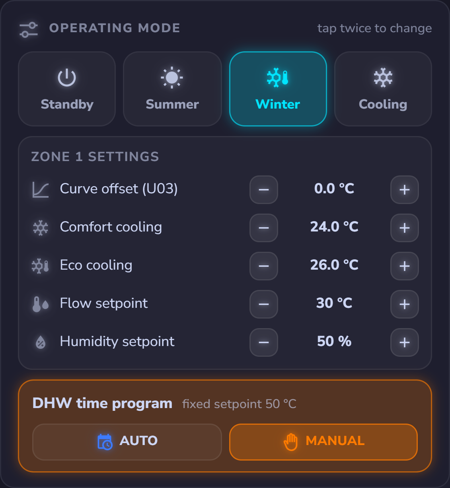 | 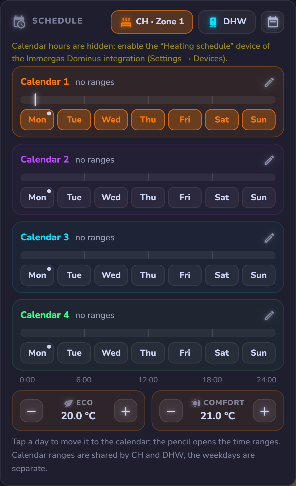 |
| 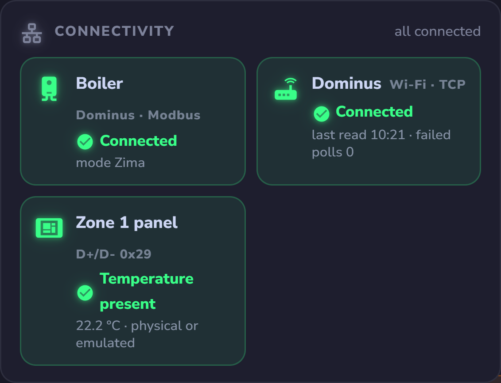 | 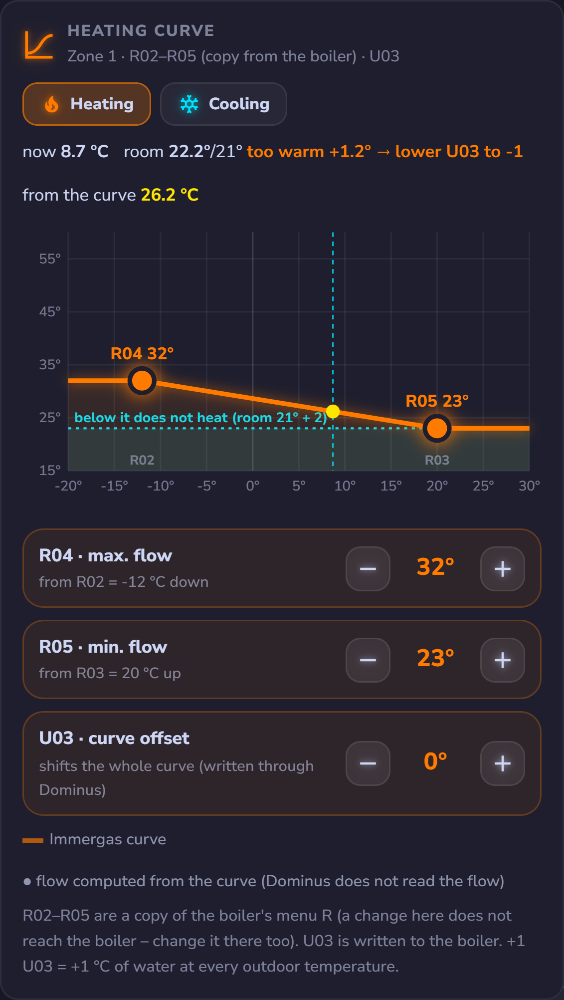 |
| 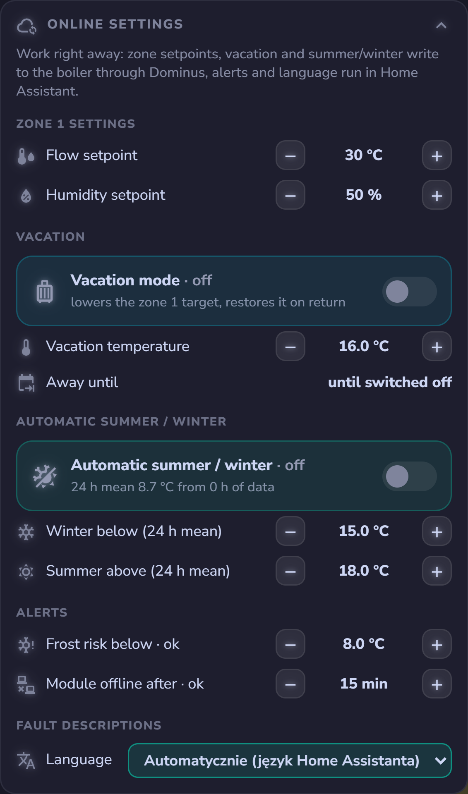 | 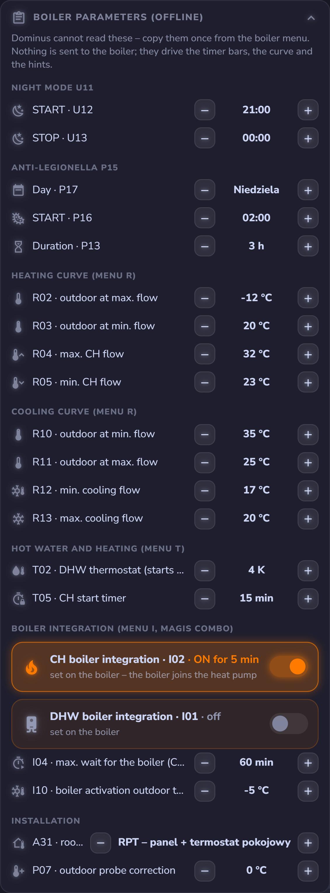 |

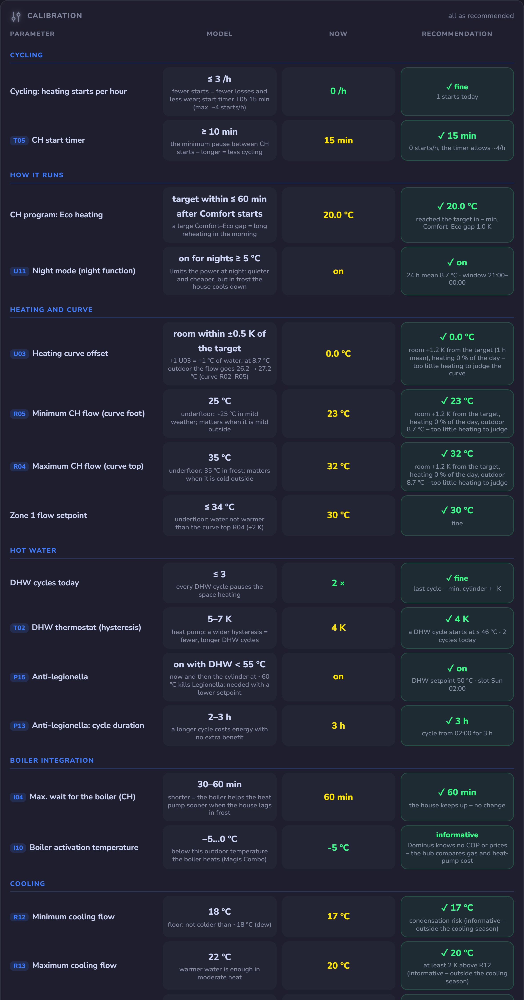

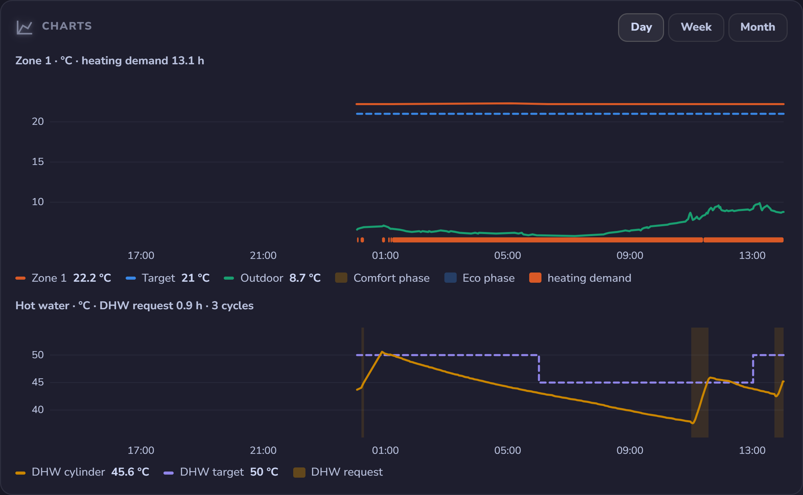

**OpenTherm without the CAR V2 remote – the Dominus as the controller (1.6.0, experimental: regulator writes not yet confirmed on a real boiler).** When the Dominus is the only
controller of an OpenTherm boiler (CAR V2 removed, the room probe of the Dominus kit connected), the integration exposes
the Dominus regulator and runs the CAR V2 programs in Home Assistant, because the module has no clock:

- **Regulator** (module parameters, Data-ID 89, as in the official app): heating curve 1–9, CH offset ±15 °C, min. CH
  temperature, building inertia 1–20, room hysteresis, modulation, room sensor, outdoor sensor, what the probe measures
  (room / outdoor), frost protection and its temperature; **room setpoint** (Data-ID 16), **room temperature** (Data-ID 24)
  and a **boiler reset** button.
- **Programs kept in Home Assistant** (restored after a restart): **CH program AUTO / MANUAL** with 4 calendars × 4 Comfort
  ranges and a calendar per weekday (CAR V2 factory program by default) – AUTO writes the Comfort / Eco room setpoint when
  the phase changes, so a manual change holds until the next change; in the Eco phase optionally **heating off**;
  **DHW Comfort / Eco** by the DHW calendar; **vacation** (heating off until a date); **automatic Summer / Winter** by the
  24 h outdoor mean; **anti-legionella** daily or on Monday at 02:00.
- The **operating mode** now shows the selected mode (enable bits) instead of what the boiler is doing right now, with the
  app's names Standby / Summer / Winter (+ CH only).

With a CAR V2 (or Super Amico) connected the remote stays in charge – leave these programs off. Turn on **Read only
(remote in charge)** (1.6.8) so that Home Assistant never writes: the Dominus keeps the last value it got from Home
Assistant (e.g. a DHW setpoint) and keeps sending it to the boiler over the remote's own until the module is
power-cycled (#2).

**OpenTherm diagnostics (1.6.1).** To find out what a boiler really supports:
**Scan Data-IDs** (button; reads every standard Data-ID once, about a minute, polling pauses meanwhile) → the
**Supported Data-IDs** sensor lists what answered, what is unsupported and the raw values; **Last write** reads every
written value back – *Taken*, or *Acknowledged, not taken* when the boiler acknowledges a write but keeps its own value;
**Status frame low byte** sends 0xCA with every Data-ID 0 frame – the "Immergas fix" of other OpenTherm gateways,
reported to unlock writes to Data-ID 1 / 57 on Immergas boilers (experimental, default standard 0x00). Data-IDs the
boiler answers as unsupported three times in a row are skipped for an hour.

**OpenTherm Data-IDs** – what the integration reads and writes and what the tested boilers answer, plus the Immergas
specifics (the remote in charge, E31, the 0xCA fix): [docs/opentherm.md](https://github.com/jotuera/immergas-dominus/blob/main/docs/opentherm.md).

**OpenTherm boilers (VICTRIX ZEUS / AVIO, STAR …).** In the OpenTherm mode the same `custom:immergas-dominus`
strategy shows the **same cards** without those that have no OpenTherm data (schedules, heating curve, calibration /
statistics, settings, automations, connectivity): **Diagram**, **Now** (flow / return, DHW, outdoor, modulation, pressure,
DHW flow rate, flame, fault), **Setpoints** (CH flow setpoint and DHW with −/+), **Operating mode** (Standby / Summer /
Winter / CH only) and **Charts** (flow / return / CH setpoint / outdoor with the flame, DHW). Add `opentherm: true` or `opentherm: false` under `strategy:` to force one
view or the other.

Heat-pump data (compressor, COP, flow / return of the heat pump, energy) is not readable through Dominus – for that
see the hub.

## Statistics and automations

Computed in Home Assistant from the registers the integration already reads (zone status `2010`, status flags `2001`,
room `2011`, target `2015`, outdoor `3002`, DHW cylinder `3016`, mode `2000`); nothing else to set up.

- **Statistics** (sensors): *CH heating time today* and *CH heating share (24 h)* (zone 1 heating demand), *DHW cycles
  today*, *Last DHW cycle duration* and *cylinder rise* (DHW request), *CH starts per hour / today*, *Room deviation from
  target (1 h)* and *Time to reach target* (after the target goes up or Eco → Comfort), *Degree days today / this
  month* (base 18 °C) and *Heating hours per degree day* (this month). Daily and monthly counters survive a restart; the
  24 h and 60 min windows start again after a restart.
- **More statistics (1.6.14)** (sensors, the *Today · analysis* card): *Time in comfort today* (room within ±0.5 °C of
  the target), *Too cold / Too warm today*, room min / max; *Room heating rate* and *Room cooling rate* (°C/h over at
  least 30 min of one state), *Building heat loss coefficient* (cooling rate ÷ (room − outdoor), 1/h) and *Suggested
  curve offset change* (+1 / 0 / −1 °C from the mean Comfort deviation of the last 3-5 days – a hint, nothing is
  written); *Comfort / Eco phase today* with the room deviation in each and *Phase changes*; *DHW heat used* and *Hot
  water used today* (cylinder drops outside the heating cycles × *DHW cylinder volume*, 200 L), *Cylinder standing
  loss* (°C/h, 01-05 without heating), cylinder minimum, *Average DHW cycle*; *Operating state* as one text; outdoor
  min / max today and *Outdoor mean 24 h*; *Module availability today* and *Link breaks*; Zones 2 / 3: heating time,
  starts and room deviation (with their devices).
- **Vacation mode** (off by default): *Vacation mode* sets the zone 1 target to *Vacation temperature* (16 °C) and
  restores the previous target when switched off or at *Vacation until*.
- **Automatic Summer / Winter** (off by default): Winter when the 24 h outdoor mean drops below *Winter below* (15 °C),
  Summer above *Summer above* (18 °C); needs 12 h of data, at most one change per hour, never touches Standby or Cooling.
- **Alerts**: *Frost risk* (room below *Frost threshold*, 8 °C) and *Dominus module offline* (no reading for *Offline
  after*, 15 min).
- **Boiler programs you declare** (not readable over TCP): *Night function U11* with start / stop (U12 / U13) and
  *Anti-legionella P15* with day, start and duration (P17 / P16 / P13). Turn the switch on when the program is set on
  the boiler; the dashboard then shows the reminder row and the timer bar. Nothing is written to the boiler.
- **Boiler parameters you copy from the boiler menu** (also not readable over TCP), all in the Settings card:
  - *Heating curve* R02–R05 and *cooling curve* R10–R13 – the Curve card draws them with the U03 offset and the flow
    computed for the current outdoor temperature; Calibration shows how many °C of water +1 U03 means.
  - *DHW thermostat T02* – the DHW cycle starts at setpoint − T02 (Now card, threshold mark on the diagram cylinder).
  - *CH start timer T05* – "CH start lock" bar after a heating demand ends; Calibration uses it for cycling.
  - *Boiler integration* (Magis Combo): switches I02 (CH) and I01 (DHW) plus I04 (max. wait) and I10 (activation
    outdoor temperature) – "Boiler joining" bar during a heating demand and a hint below I10.
  - *Room control A31* (RP / RPT / RT) – explained on the Zone 1 panel tile; *outdoor probe correction P07* – a
    reminder on the diagram when it is not 0.

  **All of them start empty** on a fresh install (a wrong default would be worse than none). Copy each value once from
  the boiler menu: an empty one is shown greyed with "not set – enter it from the boiler" and a suggested value; the
  first −/+ tap starts from that suggestion. Each feature (bar, curve, hint) turns on only when all its values are set.

## Knowledge base

The Dominus module speaks one of two protocols over its local TCP port 2000, depending on the boiler's configuration:

| Protocol | Boilers | What is documented |
|---|---|---|
| **Modbus** (main) | Magis Combo / Pro-Combo V2, Magis Pro and other `*_MBUS_*` configurations | [docs/pdu-map.md](https://github.com/jotuera/immergas-dominus/blob/main/docs/pdu-map.md) – frame, every PDU with its entity (main device, zones, time programs), PDUs found but not yet understood, what is not readable over TCP |
| **OpenTherm** | VICTRIX ZEUS / AVIO, STAR … | [docs/opentherm.md](https://github.com/jotuera/immergas-dominus/blob/main/docs/opentherm.md) – frame, every Data-ID with its entity and what the tested boilers answer, Immergas specifics, sources |

**Help map your boiler (1.6.6).** **Scan PDUs** (Modbus) or **Scan Data-IDs** (OpenTherm), fill in the **Boiler model**
and press **Report PDU map** / **Report Data-ID map**: a notification links to a **pre-filled GitHub issue** (model,
integration version, the map – no host, MAC or password). Nothing is sent automatically. Scans of other boiler models
are the most useful – each one adds a column to the tables above.

## Supported models

All boilers whose Dominus module uses the **`WFC01_IM_MBUS_MPROCOMBOV2`** configuration
share the same register map and behave the same way.

**Tested — confirmed working:**

- Magis Combo / Magis Pro-Combo V2
- Magis Pro
- Trio Hydro Hybrid 8 — reported by @FrancescoC87 ([#3](https://github.com/jotuera/immergas-dominus/issues/3))

**Same configuration — expected to work** (not individually tested; per the Dominus app `CFGS`):

- Magis Hercules Pro
- Magis Hercules Pro Mini
- Magis Hercules Mini Hydro
- Trio Pack
- Trio Hydro

(The `MPROCOMBOV2_8N2` = Magis Hercules and `MPROCOMBOV2_SYS` = system manager variants
share the map with a serial/addressing tweak.)

**Not covered — different Dominus configuration / register map:**

- **VICTRIX ZEUS / AVIO**, STAR — use the **OpenTherm** protocol (see the experimental
  OpenTherm mode above, [#2](https://github.com/jotuera/immergas-dominus/issues/2)).
- **TRIO** (`MBUS`), **SUPERIOR** (`SCP01`), **MAIOR / EXTRA** (`HDBC65`) — other Modbus
  configurations with their own register maps.

If your boiler uses the `MPROCOMBOV2` config but isn't listed, it will very likely work —
please open an issue to confirm it.

## Wiring

The Dominus module talks to the boiler over its own terminals and to Home Assistant over Wi-Fi (local TCP 2000) –
nothing else to connect for the integration. Three typical installations:

**Modbus – MAGIS PRO / COMBO V2** (Dominus on D+ / D−, an ON / OFF room thermostat optional on the zone 1 input):

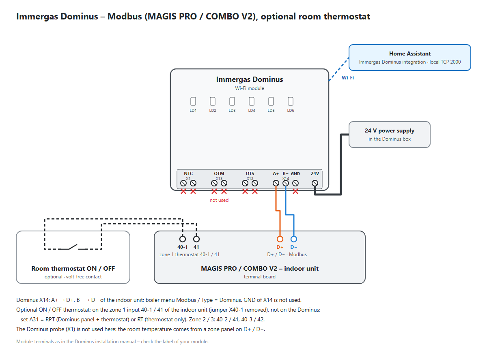

**OpenTherm with the CAR V2** (the remote stays in charge – turn on *Read only (remote in charge)*):

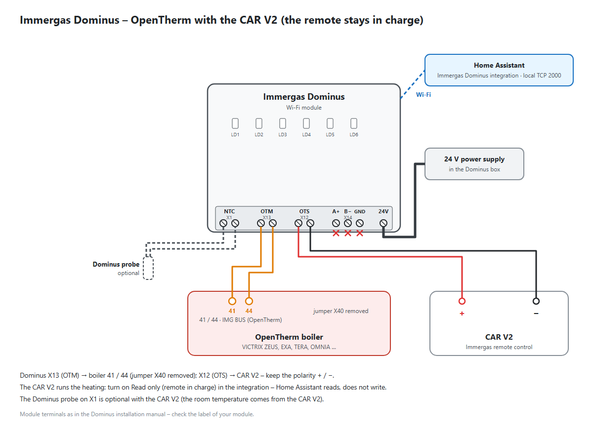

**OpenTherm without the CAR V2** (Home Assistant in charge – see [Replacing the CAR V2](https://github.com/jotuera/immergas-dominus/blob/main/docs/opentherm.md#replacing-the-car-v2)):

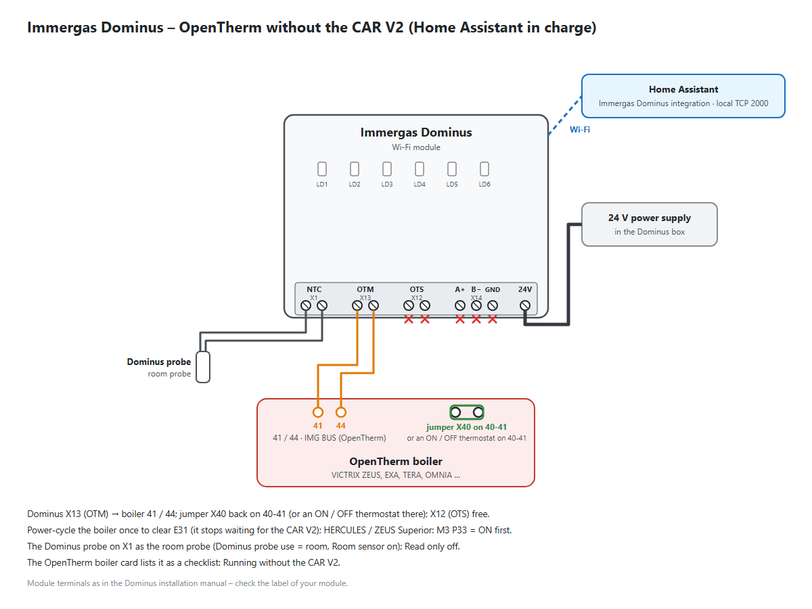

Module terminals as in the Dominus installation manual (X1 NTC probe, X13 OTM boiler, X12 OTS remote, X14 A+ / B− /
GND, 24 V supply) – check the label of your module. Boiler terminals per model: [OpenTherm – Boilers and terminals](https://github.com/jotuera/immergas-dominus/blob/main/docs/opentherm.md#boilers-and-terminals).

## Installation

### HACS (custom repository)

1. HACS → *Integrations* → ⋮ → *Custom repositories*.
2. Add `https://github.com/jotuera/immergas-dominus`, category *Integration*.
3. Install **Immergas Dominus**, restart Home Assistant.
4. *Settings → Devices & services → Add integration → Immergas Dominus*.

### Manual

Copy `custom_components/immergas_dominus` into your Home Assistant `config/custom_components/`
directory, restart Home Assistant, then add the integration as above.

The first local TCP session can be rejected by the Dominus module (e.g. just after the
mobile app was used); the integration creates the entities anyway and values appear once
the module accepts the session.

## Notes

- Fault descriptions are the project's own wording (11 languages), shared with the
  IMMERGAS Modbus BMS NASA OpenTherm HUB; fault codes and their meaning follow the boiler documentation.
- Registers confirmed only on the D+/D- bus (schedule, fault flags) are cross-checked but
  may need verification over TCP AUTH on other models.

## Changelog

### 1.6.22

- **Card themes:** *Online settings* → *Card theme* picks Automatic, Light, Dark or Mocha Neon for this browser; the option
  `theme: auto | light | dark | neon` sets it for a card or the dashboard strategy. Mocha Neon is built into the cards and
  needs no theme in Home Assistant; the top bar, side menu and pop-ups still follow your Home Assistant theme.
- **Dark look:** without a Catppuccin theme the cards now use vivid colours instead of pastels.
- Frontend: hub cards 0.90.0.

### 1.6.21

- **OpenTherm dashboard:** *Online settings* and *Boiler parameters (offline)* moved under *Automations*, side by side
  (one under the other on a phone).
- Frontend: hub cards 0.89.4.

### 1.6.20

- **OpenTherm diagram – heating temperature:** OpenTherm has one flow reading, the boiler water (Data-ID 25). While the
  boiler heats the cylinder and for 3 minutes after, the house keeps the last heating value, marked *before DHW*.
- **OpenTherm diagram – CH limit:** with an outdoor probe, parameter 17 is shown as *max.*: it is the upper limit of the
  flow, not the actual target.
- Frontend: hub cards 0.89.3.

### 1.6.19

- **Light theme:** on a light Home Assistant theme the cards now use a darkened version of their colours, paler highlights
  and stronger helper texts, so everything stays readable on white. The dark look does not change.
- The day of the anti-legionella program fits its tile.
- Frontend: hub cards 0.89.2.

### 1.6.18

- **Cards in 9 languages:** 998 card texts that were still shown in English are now translated (cs, de, es, fr, hu, it, nl,
  pt, sk). Machine translation, corrections are welcome.
- **OpenTherm dashboard:** *Connectivity* moved under *Charts*, four tiles in one row.
- **Optimisation effectiveness:** each period counts only the hours that have all the statistics, so a meter with a longer
  history no longer distorts the "before" column.
- Frontend: hub cards 0.88.0.

### 1.6.17

- **OpenTherm – CH supervision:** is a CH demand really taken up by the boiler. *CH supervision* names the state
  (confirmed, DHW priority, flow near the setpoint, fault, no demand, waiting), *CH: boiler not responding* comes on after
  a set time (default 15 min). The demand is inferred from the CH enable bit, the control setpoint and the room
  temperature; with a physical thermostat on the boiler contacts it cannot be seen. Diagnosis only, nothing is written.
- Frontend: hub cards 0.87.0.

### 1.6.16

- **Translations:** the 68 entity names added in 1.6.x (Today · analysis statistics, OpenTherm computed values, gas
  price, DHW cylinder volume) now in all 11 languages – before they showed in English outside English and Polish.
- **Wiring diagrams** in the README: Modbus (MAGIS PRO / COMBO V2, optional room thermostat), OpenTherm with and without
  the CAR V2.
- Frontend: hub cards 0.86.0 (the ESP OpenTherm / gas boiler / MAGIS M hubs found in every language, entity names
  without "/"). CHANGELOG, SECURITY and CONTRIBUTING in Polish; the HACS description updated.

### 1.6.15

- **OpenTherm – Running without the CAR V2** (*Online settings* card) fits a weather-compensated boiler: with the
  Dominus regulator on the outdoor probe, the boiler's own curve (ZEUS Superior / HERCULES P66 in *Boiler parameters
  (offline)*) or an outdoor temperature without a room temperature, the room rows (*Dominus probe in the room*,
  *Room control (AMB)*) are informational – *not needed – weather compensation*.
- The hint for running without the remote names the IMG BUS terminals **41 / 44** on the ZEUS Superior 26 / 32
  (42 / 43 are the Super CAR terminals), confirmed on a ZEUS Superior 26 2 ErP. Frontend: hub cards 0.84.2.

### 1.6.14

- **Today · analysis** card (both modes) – values computed in Home Assistant, nothing written to the boiler.
- **Modbus – more statistics** (`stats_extra`): comfort today (time in comfort, too cold / too warm, room min / max),
  building (room heating / cooling rate, heat loss coefficient, a suggested curve offset change – only a hint), Comfort /
  Eco phases, DHW (heat and hot water used today from the new **DHW cylinder volume**, standing loss, cylinder minimum,
  mean cycle), operating state, outdoor min / max / 24 h mean, module availability and link breaks, zones 2 / 3.
- **OpenTherm – computed values** (`ot_computed`): delta T, control setpoint and deviation, condensing, burner power,
  gas / heat today and a gas counter with the **gas price**, short cycling, DHW draws and cycles, operating state,
  pressure drop / leak warning, flame current, fan deviation, room deviation, degree days.
- Frontend: hub cards 0.84.0 – *Calibration* and *Automations* also in the OpenTherm dashboard, the OpenTherm weather
  curve and the Data-ID map.

### 1.6.13

- **Device type** (Modbus): *Heat pump* or *Gas boiler* (VICTRIX ZEUS Superior 25-35, HERCULES, EXTRA on the new
  platform). A gas boiler drops *Cooling* from the operation mode and the climates, and the dashboard hides the heat
  pump values (cooling Comfort / Eco and curve, humidity, night function U11, boiler integration I01–I10). The
  [Modbus map](docs/pdu-map.md) has a *Gas boilers* section – the PDU scan report confirms the map for a gas boiler.
  Frontend: hub cards 0.59.0.

### 1.6.12

- **Emulated thermostat failsafe** (OpenTherm): with no fresh, valid temperature from the source entity for 60 minutes,
  Data-ID 24 is no longer sent and the **Thermostat** tile turns red (*No room temperature source*); sending resumes
  by itself. New attributes `source_lost` and `source_age_min` on *Room thermostat*.
- Knowledge base: **Boilers and terminals** in [OpenTherm](docs/opentherm.md) – where an OpenTherm unit goes on the
  VICTRIX EXA / ZEUS / TERA, and why every OpenTherm master rewrites the DHW setpoint.
- **Boiler menu families** from the Immergas installer manuals: *Boiler menu profile* now has VICTRIX ZEUS 25 / EXA 28 /
  OMNIA, **TERA V2 / V3**, **EXA 24 X / NIKE 24 ECO**, ZEUS Superior 26 / 32 and **HERCULES Condensing / Solar 26** – the
  *Boiler parameters (offline)* card shows each family's codes. New declared values: TERA P7 remote protocol, HERCULES
  P57 pump control and M3 P33 *CH without a working remote* (also on the *Running without the CAR V2* checklist). The
  new platform (ZEUS Superior 25-35, HERCULES 25 / 35, EXTRA) is documented as a Modbus boiler.
- **Optimum start** (OpenTherm, CH program AUTO): Comfort starts early by the learned heat-up rate (°C/h), at most
  120 min by default. **Open window**: window / door sensors put the room setpoint to 7 °C while one is open – both on
  the *Operating mode* card. Frontend: hub cards 0.58.0.

### 1.6.11

- **OpenTherm diagnostics from a VICTRIX ZEUS Superior scan** (disabled by default): remote boiler parameters
  (Data-ID 6 – is the DHW / max CH setpoint offered for remote setting), the boiler day / time (Data-ID 20) and the solar
  cylinder / collector and DHW 2 temperatures (Data-ID 29 / 30 / 32, empty without a probe).

### 1.6.10

- **OpenTherm: boiler menu profiles** – *Boiler menu profile* (VICTRIX ZEUS 25 / VICTRIX ZEUS Superior / generic, or a
  guess from the boiler model) picks the codes, ranges and units of the **Boiler parameters (offline)** card. Superior:
  climatic curve P66/A–D, P68–P71, outputs as fan speeds (P57 / P62 / P64 / P65), pump P55 / P67, P76 and the M1
  counters (operating hours, burner ignitions) – see the [menu profiles](https://github.com/jotuera/immergas-dominus/blob/main/docs/opentherm.md#boiler-menu-declared-offline).
- **OpenTherm: emulated thermostat** judged by reading Data-ID 24 back (*it works* / *the module does not take it*);
  the choice and the source entity moved to the Boiler parameters (offline); the Thermostat tile turns red when there
  is no room temperature but the emulated thermostat or room control (AMB) needs it.
- Cards 0.56.1: the OpenTherm mode names (Standby / Summer / Winter / CH only) on every card; Dominus Connectivity in two
  columns (boiler + thermostat, Dominus + zone 1 panel / CAR V2); README icon.

### 1.6.9

- **OpenTherm dashboard** (cards 0.54.0): new **OpenTherm boiler** card (capacity, min. modulation, CH / DHW range,
  DHW type, exhaust, fan, burner starts, fault flags and fault history, boiler reset, read-only switch) and **Data-ID
  map** card (scan, boiler parameters, report); with *Read only* on, the controls show a lock instead of writing; the
  result of the last write under the setpoints; pressure / DHW flow tiles hidden when the boiler does not report them;
  exhaust on the boiler chart, a burner modulation chart and burner hours per day.
- **OpenTherm: burner starts today / in the last hour and burner hours today** (counted from the flame flag every
  polling cycle – very short burns may be missed) and the **boiler fault description** (Data-ID 5 code, e.g. E31).
- Documentation: a knowledge base in `docs/` – Modbus over TCP (every PDU with its entity) and OpenTherm (the Data-ID
  table moved out of the README).
- **OpenTherm Connectivity** (cards 0.54.1): Dominus, the boiler and a **CAR V2 remote** tile instead of the zone 1
  panel – E31 (remote lost), room temperature present, *Read only* on – with the switch that blocks writes from HA.
- **OpenTherm: the HA programs are paused while the remote is in charge** (*Read only* on): CH / DHW program,
  anti-legionella, vacation and automatic Summer / Winter do not write and cannot be switched on; the cards show them
  greyed out with a lock (cards 0.54.2). **Anti-legionella** never asks more than the boiler's DHW maximum (Data-ID 48,
  60 °C on a VICTRIX ZEUS) – above it the target was never reached and the run lasted 3 h.
- **OpenTherm: the rest of the CAR V2** so the remote can be removed – Eco phase **lower the flow setpoint** (RIDOTT
  ON), **self-learning** of the CH offset (AUTO A), **maintenance reminder** (MANUTZ), vacation as **Standby** (CH and
  DHW off, as the CAR V2) or Summer, DHW Eco down to the boiler minimum, anti-legionella held 20 min, boiler reset
  limited to 5 attempts per hour; a *Running without the CAR V2* checklist on the OpenTherm boiler card (cards 0.54.3).
- **OpenTherm: boiler menu declared offline** (t0 / t1, t2, t4–t7, P0–P2, P6, P7, A3–A5) with hints – e.g. t5 when
  the burner short-cycles; **Boiler parameters (offline)** card on the OpenTherm dashboard (cards 0.55.2).
- **Modbus: Thermostat tile** on the Connectivity card from the declared A31 room control (RP / RPT / RT, Boiler
  parameters offline); a room temperature written over TCP is not taken by the module (tested), the hub's emulated zone
  panel does it (cards 0.55.4).
- **OpenTherm: room thermostat** – none / physical (contacts 40-41) / **emulated**: an HA entity's temperature goes to
  the module as Data-ID 24 (experimental); a Thermostat tile on the Connectivity card (cards 0.55.3).
  See [Replacing the CAR V2](https://github.com/jotuera/immergas-dominus/blob/main/docs/opentherm.md#replacing-the-car-v2).

### 1.6.8

- **OpenTherm: Read only (remote in charge)** – a switch that blocks every write from Home Assistant (controls, programs,
  reset); readings and the displayed setpoints stay. For a boiler controlled by its CAR V2 / Super Amico: a value written
  once from Home Assistant is kept by the Dominus and overrides the remote until the module is power-cycled (#2).

### 1.6.7

- **OpenTherm: Scan Data-IDs also reads the boiler's own parameters** (transparent slave parameters, Data-ID 10 / 11 –
  42 on a VICTRIX ZEUS 25 ErP) and the **fault history** (Data-ID 12 / 13) when the boiler reports them: attributes
  *boiler_parameters* / *fault_history* of *Supported Data-IDs* and in **Report Data-ID map**. Their meaning is not
  published by Immergas – a report together with the boiler's P / t / A / F menu values helps to map them.

### 1.6.6

- **PDU scanner** (Modbus mode): scan a PDU range through the Dominus TCP, the map in a sensor, and **Report PDU map**
  – a link to a pre-filled GitHub issue with the boiler model (nothing is sent automatically).
- **OpenTherm: Report Data-ID map** – the same report for the Data-ID scan.
- **OpenTherm: fan speed and setpoint** (Data-ID 35), **flame current** (Data-ID 36) and **fault history**
  (Data-ID 12/13: the number of entries, each code with its description in the attributes) – found on a VICTRIX ZEUS
  25 ErP. Disabled by default (not every boiler answers them): enable them in the device's *Diagnostic* entities.
- **OpenTherm: Last write** no longer reports a false *Acknowledged, not taken*: a setpoint within 0.5 °C of the sent
  value counts as taken (some boilers store 45.0 as 44.7), and a mismatch is read again up to 3× after 5 s, because
  right after a write the module may still answer the previous value (attribute *rechecks*).

### 1.6.5

- **Home Assistant 2026.11:** the thermostats use the new `native_*` temperature properties (the old ones are
  deprecated and stop working in 2027.11); older Home Assistant versions keep working.
- README: absolute image links (the cards were missing in the HACS store view).

### 1.6.4

- **Stable release of the 1.6 line.** Confirmed on real OpenTherm boilers (VICTRIX ZEUS, #2): the OpenTherm dashboard
  and its automatic detection, the readings, the Data-ID scan. The Dominus regulator and the programs kept in Home
  Assistant (1.6.0) stay experimental until a tester confirms the writes.
- **OpenTherm fault flags** (Data-ID 5): low water pressure, gas / flame fault, air pressure fault, water
  over-temperature, service request – e.g. a low-pressure alert on boilers that do not publish the pressure (#2).

### 1.6.3 (pre-release)

- **OpenTherm dashboard detected automatically** also when Home Assistant still keeps entities from an earlier Modbus
  setup (orphaned registry entries no longer count); `opentherm: true` is not needed any more (#2). Cards 0.52.4.
- Cards 0.52.3: T05 max. 15 min.

### 1.6.2 (pre-release)

- **OpenTherm:** exhaust temperature (Data-ID 33), boiler max. capacity and min. modulation (Data-ID 15); the DHW and
  CH setpoint sliders follow the limits the boiler reports (Data-ID 48 / 49) (#2).
- Cards 0.52.2.

### 1.6.1 (pre-release)

- **OpenTherm diagnostics:** Data-ID scan (button + sensor with the supported / unsupported lists), read-back of every
  write (*Taken* / *Acknowledged, not taken*), optional 0xCA low byte in the Data-ID 0 frames (the "Immergas fix" of
  other OpenTherm gateways, experimental), unsupported Data-IDs skipped for an hour (#2).

### 1.6.0 (pre-release, OpenTherm features need testing)

- **OpenTherm – the Dominus regulator** (Data-ID 89 module parameters as in the official app): heating curve, CH offset,
  min. CH temperature, building inertia, room hysteresis, modulation, room / outdoor sensor, probe use, frost protection;
  room setpoint (Data-ID 16), room temperature (Data-ID 24), boiler reset button (#2).
- **OpenTherm – programs kept in Home Assistant** for a Dominus without the CAR V2 remote: CH program AUTO / MANUAL with
  4 calendars and a calendar per weekday, Eco phase setpoint or heating off, DHW Comfort / Eco by the DHW calendar,
  vacation, automatic Summer / Winter, anti-legionella. All off by default.
- **OpenTherm – operating mode** shows the selected mode (master status enable bits) instead of the current activity, with
  the app's names Standby / Summer / Winter (+ CH only).
- **OpenTherm dashboard** on the Dominus cards (diagram, now, setpoints, mode, settings, schedule, charts); cards 0.52.0.

### 1.5.8

- **Reduced dashboard for OpenTherm boilers** (VICTRIX ZEUS / AVIO, STAR …): the `custom:immergas-dominus` strategy
  detects the OpenTherm mode and builds Now / Control / History from standard Home Assistant cards; `opentherm: true` /
  `false` forces the view (#2).
- Dashboard cards 0.51.5.

### 1.5.7

- **Zone 1 CH time program AUTO / MANUAL** (new select, like the official app): MANUAL puts every day on a whole-day
  calendar (fixed setpoint 24 h), AUTO restores the previous day assignment and never leaves a day on a whole-day calendar.
  A panel set to MANUAL (zone status bit) is shown as MANUAL too.
- A dropped schedule write is retried, so the AUTO / MANUAL switch never stops half-way.
- Dashboard cards 0.51.4 (I09 recommendation kept when DHW is heated by the boiler, schedule mode row).
- README: CAR V2 (Amico V2) behaviour with OpenTherm boilers; CH setpoint write confirmed on a VICTRIX ZEUS 25 ErP (#2).

### 1.5.6

- OpenTherm (VICTRIX): the **CH setpoint** is now read and written as module parameter 17 (Data-ID 89, HB = 17,
  LB = °C), exactly as the official app does; the **DHW setpoint** is written in whole degrees (HB = °C, LB = 0) (#2).

### 1.5.5

- OpenTherm (VICTRIX): the raw bytes of every write and of a reply that cannot be decoded are logged at debug level,
  to find out what the module expects for setpoint writes (#2).

### 1.5.4

- **Home Assistant 2026.11:** sub-device entities (zones, schedule) are added again – the parent device is linked by id
  and the schedule time entities use a proper entity description.
- **Alert notifications** switch: frost risk, module offline or a boiler fault raise a Home Assistant notification,
  cleared when the alert ends (on by default).
- Outdoor, room and DHW cylinder temperatures keep long-term statistics.
- Cards 0.51.0: **Automations** card for the built-in automations and alerts (summer / winter, vacation, DHW schedule,
  notifications, frost, module offline, boiler fault) and **optimisation effectiveness** in Calibration (heating hours
  per degree day, starts, room deviation; optional `energy_entity` / `gas_entity`); floor screed type and heated area
  in the online settings.

### 1.5.3

- **OpenTherm (VICTRIX and other non-Modbus boilers):** the session is released after every polling cycle, so the
  official Dominus app can connect in between (the module serves one TCP client at a time). A failed write now reports
  its real cause instead of an AssertionError.
- New boiler parameters to enter once: **floor screed type** (cement / anhydrite / dry system) and **heated floor area**.
- Cards 0.50.1: Calibration uses the screed type (floor limit, setbacks, CH schedule, I04), shows the building heat
  loss (W/K and W/m², once enough heating days are collected), the curve card ignores the flow while DHW heats, cycle
  statistics skip reboot gaps, the cycling rows get a Set button (R05 / T05).

### 1.5.2

- Cards 0.47.0: all dashboard texts in all 11 languages.
- The cards are loaded only once: when the IMMERGAS Modbus BMS NASA OpenTherm HUB cards are installed as a Lovelace resource,
  the integration uses them instead of its own (possibly older) copy.

### 1.5.1

- Calibration: recommendations from the boiler parameters copied by hand – T02, T05, U11, P15 / P13, I04, I10,
  A31 and P07; Settings split into online and offline; zone 1 flow and humidity setpoints in the online settings.

### 1.5.0

- **More declared boiler parameters**: heating curve R02–R05, cooling curve R10–R13, DHW thermostat T02, CH start timer
  T05, boiler integration I01 / I02 / I04 / I10, room control A31 and outdoor probe correction P07 – the Curve card
  (new on the dashboard), Now card bars (CH start lock, boiler joining, DHW start threshold), diagram hints and
  Calibration texts use them.
- **Declared values start empty** (also the 1.4.0 night function and anti-legionella values on a new install) and show
  a suggested value until you copy the real one from the boiler. Values you already entered are kept.

### 1.4.0

- **Declared boiler programs**: night function U11 (start / stop) and anti-legionella P15 (day, start, duration) as
  switches and settings kept in Home Assistant – the Operating mode card shows them like the hub, and the Now card
  shows their timer bars while the switch is on. Nothing is written to the boiler.

### 1.3.0

- **Statistics and automations** computed in Home Assistant: CH heating time and share, DHW cycles, CH starts, room
  deviation and time to target, degree days and heating hours per degree day; vacation mode, automatic Summer / Winter
  (both off by default), frost and module-offline alerts. Names in all 11 languages.

### 1.2.0

- **Fault language** select (configuration): the fault description in the Home Assistant language (default) or in one
  of the 11 languages, whatever language Home Assistant uses.
- Dashboard: **Settings** card with the fault language, zone 1 settings in the Operating mode card (cooling / heating
  Comfort / Eco, flow and humidity setpoints), the Schedule card always shown (with a hint when the calendar hours are
  disabled).

### 1.1.0

- **Dashboard**: the integration serves the Immergas Hub cards and loads them in Home Assistant; a new dashboard with
  `strategy: {type: custom:immergas-dominus}` shows Now, Setpoints, Operating mode, Schedule and Connectivity.

### 1.0.0

- **New license**: PolyForm Noncommercial 1.0.0 (free for personal and other noncommercial use).
- **Own boiler fault descriptions** (`2100`), 113 codes in 11 languages, written for this project and shared
  with the [IMMERGAS Modbus BMS NASA OpenTherm HUB](https://github.com/jotuera/immergas-modbus-bms-nasa-opentherm-hub).
  Code 0 shows "No faults".
- **Writes no longer jump back**: after a confirmed write the module can still report the old value for a
  poll or two; for 30 s such a read keeps the written value.
- **Comfort / Eco presets** on the zone thermostats: the preset shows the zone's program phase (`2010`), choosing
  one sets the zone target to its Comfort / Eco setpoint (`2210`/`2211`, cooling `2214`/`2215`).
- **Connection diagnostics**: `Last successful read` and `Failed polls` (attribute `missing_in_last_poll`).
- Earlier development versions (0.2–0.6) built everything listed under *Features*: operation mode, zones 1–3,
  heating and DHW schedules, DHW Comfort / Eco, fault reporting, experimental OpenTherm mode, 11 UI languages.

## Related project

**Want the full heat-pump picture?** The [**IMMERGAS Modbus BMS NASA OpenTherm HUB**](https://github.com/jotuera/immergas-modbus-bms-nasa-opentherm-hub)
is one ESPHome device (M5Stack AtomS3) on all three buses of a Magis Pro / Magis Combo V2 – D+/D- Modbus, T-/T+ BMS
and F1/F2 Samsung NASA. It adds what the Dominus module does not carry: the heat pump and compressor, COP, gas, DHW by
the heat pump and the full calibration. The dashboard cards this integration uses come from the hub.

## Support

If you find this integration useful, please consider supporting me by buying me a coffee. Thank you!

<a href="https://buymeacoffee.com/jotuera"></a>

## Brand assets

Bundled Home Assistant brand assets live in `custom_components/immergas_dominus/brand/`.
The icon is original project artwork (red background, white thermostat and wireless
symbols) and does not copy Immergas/Dominus app artwork.

## License

[PolyForm Noncommercial 1.0.0](https://github.com/jotuera/immergas-dominus/blob/main/LICENSE) © JoTu: free for personal and other noncommercial use – at home, for your
own boiler, for learning and research. **Commercial use** (installers, resellers, building it into a paid product)
needs a separate license – please get in touch through GitHub. See also [CONTRIBUTING](https://github.com/jotuera/immergas-dominus/blob/main/CONTRIBUTING.md).
Not affiliated with or endorsed by Immergas.
