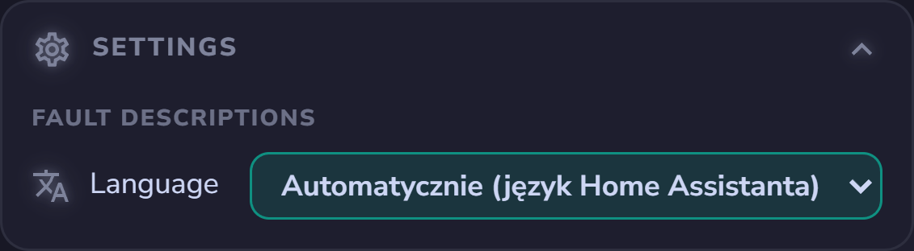

# Immergas Dominus

<p align="center">
  <a href="https://github.com/hacs/integration"></a>
  
  
  <a href="LICENSE"></a>
  <a href="https://buymeacoffee.com/jotuera"></a>
</p>

**🇬🇧 English** · [🇵🇱 Polski](README.pl.md)

Author: **JoTu** ([github.com/jotuera](https://github.com/jotuera))

Home Assistant custom integration for **local** control of an Immergas boiler through
the **Dominus** Wi-Fi module — no cloud, no MQTT. Home Assistant talks directly to the
Dominus module over local TCP (default port `2000`) using the module MAC and password.

> **Tested on Immergas Magis Combo, Magis Pro and Trio Hydro Hybrid 8** (the `MPROCOMBOV2`
> Dominus configuration). See [Supported models](#supported-models) for the full list.

> **Compatibility — two protocols.** Magis Combo / Pro (`*_MBUS_*` configs) use the
> 7-byte **Modbus** protocol — fully supported. Boilers whose Dominus config has no
> `modbus` flag — e.g. **VICTRIX ZEUS / AVIO**, STAR — use a 6-byte **OpenTherm**
> protocol; since 0.4.0 there is an **experimental OpenTherm mode** (pick it in the config
> flow). **Reading is verified on a VICTRIX ZEUS 25 ErP**; since 0.4.1 it also exposes
> **experimental writes** (CH / DHW setpoint, mode) that still need confirmation. See issue
> [#2](https://github.com/jotuera/immergas-dominus/issues/2).

The interface is **English by default**, with a full **Polish** translation. The
integration version and author are also shown on each Dominus device page in Home
Assistant (the *Firmware* field, e.g. `0.3.0 — JoTu`).

## Features

- Local TCP connection, config flow (host/IP, port, Dominus MAC, Dominus password).
- No cloud dependency, no MQTT, no sniffer, no debug/raw-PDU entities.
- Last-known-good caching and dynamic polling — only PDUs of **enabled** entities are read.

### Main device

- Sensors: outdoor temperature (`3002`, `0xFF` = no probe), DHW tank temperature (`3016`).
- Operation mode select (`2000`): Standby / Summer / Cooling / Winter.
- DHW target (`2095`) and DHW thermostat.
- **DHW Comfort / Eco**: `DHW Comfort target` / `DHW Eco target` (default 50 / 45 °C) and the switch
  `DHW Comfort-Eco by schedule`. When on, the DHW target follows the DHW schedule (weekday `2490`–`2496`
  → Cal 1–4, `2310`–`2347`): Comfort inside the ranges, Eco outside; works with the zone 1 program in
  Manual too. `DHW phase` shows the current phase.
- **Boiler fault reporting** (like the Dominus app): fault code (`2100`), fault description
  (the project's own texts, 113 codes, in the Home Assistant language), `Boiler fault`
  (binary, *problem*) and `Reset available` (binary, `2101` bit 1).

### Zone 1 (and disabled-by-default Zone 2 / Zone 3)

- Room temperature, heating target, heating curve offset (U03), comfort/eco heat & cool,
  humidity and flow setpoints (sliders), plus a heating thermostat.
- Per-zone registers are offset by `+10` per zone (Zone 1 `2011/2015/2210…`,
  Zone 2 `2021/2025/2220…`, Zone 3 `2031/2035/2230…`). Zone 2/3 devices are disabled by
  default; enable the device to bring all its entities online.

### Heating schedule (disabled by default)

- 4 shared day profiles (Cal 1–4) × 4 comfort periods, each a start/end `time`
  (`2310`–`2347`, high byte = hour, low byte = minute; `24:00` shown as `23:59`).
- Weekday → profile assignment for Zone 1 (`2410`–`2416`), plus a
  **Set the same profile for all days** shortcut.

## Dashboard

The integration brings its own dashboard cards (the same cards as the
[IMMERGAS Modbus BMS NASA Hub](https://github.com/jotuera/immergas-modbus-bms-nasa-hub), in a reduced view). Nothing
else to install: create a new dashboard (*Settings → Dashboards → Add dashboard*), open it, *⋮ → Edit dashboard →
⋮ → Raw configuration editor* and enter

```yaml
strategy:
  type: custom:immergas-dominus
```

- **Now** – what the boiler is asked for (heating / hot water), mode, program phase, CH and DHW setpoints, outdoor,
  zone 1 and DHW cylinder temperatures, active fault.
- **Setpoints** – zone 1 and DHW with −/+ and the Comfort / Eco profiles.
- **Operating mode** – Standby / Summer / Winter / Cooling (tap twice), zone 1 program phase, zone 1 settings
  (curve offset U03, the Comfort / Eco pair of the other mode, flow and humidity setpoints), DHW Comfort / Eco by the
  schedule.
- **Schedule** – the four calendars and the weekdays for CH and DHW. The calendar hours need the *Heating schedule*
  device (disabled by default); the card says so when it is off.
- **Connectivity** – the Dominus module (last successful read, failed polls) and the boiler behind it.
- **Settings** – vacation mode, automatic Summer / Winter, alert thresholds and the language of the fault description.
- **Calibration** – the heating curve offset (U03) with a recommendation from the room deviation and a **Set** button,
  cycling, DHW cycles per day, the Comfort–Eco gap and heating hours per degree day.
- **Charts** – day: zone 1 room / target / outdoor with the program phases and heating demand, DHW cylinder with the
  DHW requests; week / month: hours of CH and DHW demand per day and the mean outdoor temperature.

| | |
|---|---|
|  |  |
|  |  |
|  |  |


Heat-pump data (compressor, COP, flow / return of the heat pump, energy) is not readable through Dominus – for that
see the hub.

## Statistics and automations

Computed in Home Assistant from the registers the integration already reads (zone status `2010`, status flags `2001`,
room `2011`, target `2015`, outdoor `3002`, DHW cylinder `3016`, mode `2000`); nothing else to set up.

- **Statistics** (sensors): *CH heating time today* and *CH heating share (24 h)* (zone 1 heating demand), *DHW cycles
  today*, *Last DHW cycle duration* and *cylinder rise* (DHW request), *CH starts per hour / today*, *Room deviation from
  target (1 h)* and *Time to reach target* (after the target goes up or Eco → Comfort), *Degree days today / this
  month* (base 18 °C) and *Heating hours per degree day* (this month). Daily and monthly counters survive a restart; the
  24 h and 60 min windows start again after a restart.
- **Vacation mode** (off by default): *Vacation mode* sets the zone 1 target to *Vacation temperature* (16 °C) and
  restores the previous target when switched off or at *Vacation until*.
- **Automatic Summer / Winter** (off by default): Winter when the 24 h outdoor mean drops below *Winter below* (15 °C),
  Summer above *Summer above* (18 °C); needs 12 h of data, at most one change per hour, never touches Standby or Cooling.
- **Alerts**: *Frost risk* (room below *Frost threshold*, 8 °C) and *Dominus module offline* (no reading for *Offline
  after*, 15 min).
- **Boiler programs you declare** (not readable over TCP): *Night function U11* with start / stop (U12 / U13) and
  *Anti-legionella P15* with day, start and duration (P17 / P16 / P13). Turn the switch on when the program is set on
  the boiler; the dashboard then shows the reminder row and the timer bar. Nothing is written to the boiler.
- **Boiler parameters you copy from the boiler menu** (also not readable over TCP), all in the Settings card:
  - *Heating curve* R02–R05 and *cooling curve* R10–R13 – the Curve card draws them with the U03 offset and the flow
    computed for the current outdoor temperature; Calibration shows how many °C of water +1 U03 means.
  - *DHW thermostat T02* – the DHW cycle starts at setpoint − T02 (Now card, threshold mark on the diagram cylinder).
  - *CH start timer T05* – "CH start lock" bar after a heating demand ends; Calibration uses it for cycling.
  - *Boiler integration* (Magis Combo): switches I02 (CH) and I01 (DHW) plus I04 (max. wait) and I10 (activation
    outdoor temperature) – "Boiler joining" bar during a heating demand and a hint below I10.
  - *Room control A31* (RP / RPT / RT) – explained on the Zone 1 panel tile; *outdoor probe correction P07* – a
    reminder on the diagram when it is not 0.

  **All of them start empty** on a fresh install (a wrong default would be worse than none). Copy each value once from
  the boiler menu: an empty one is shown greyed with "not set – enter it from the boiler" and a suggested value; the
  first −/+ tap starts from that suggestion. Each feature (bar, curve, hint) turns on only when all its values are set.

## Knowledge base: registers over TCP

Which boiler registers (PDUs) the Dominus module answers over local TCP – frame, values, zones, time programs, what
is not readable, OpenTherm Data-IDs: [docs/pdu-map.md](docs/pdu-map.md).

## Supported models

All boilers whose Dominus module uses the **`WFC01_IM_MBUS_MPROCOMBOV2`** configuration
share the same register map and behave the same way.

**Tested — confirmed working:**

- Magis Combo / Magis Pro-Combo V2
- Magis Pro
- Trio Hydro Hybrid 8 — reported by @FrancescoC87 ([#3](https://github.com/jotuera/immergas-dominus/issues/3))

**Same configuration — expected to work** (not individually tested; per the Dominus app `CFGS`):

- Magis Hercules Pro
- Magis Hercules Pro Mini
- Magis Hercules Mini Hydro
- Trio Pack
- Trio Hydro

(The `MPROCOMBOV2_8N2` = Magis Hercules and `MPROCOMBOV2_SYS` = system manager variants
share the map with a serial/addressing tweak.)

**Not covered — different Dominus configuration / register map:**

- **VICTRIX ZEUS / AVIO**, STAR — use the **OpenTherm** protocol (see the experimental
  OpenTherm mode above, [#2](https://github.com/jotuera/immergas-dominus/issues/2)).
- **TRIO** (`MBUS`), **SUPERIOR** (`SCP01`), **MAIOR / EXTRA** (`HDBC65`) — other Modbus
  configurations with their own register maps.

If your boiler uses the `MPROCOMBOV2` config but isn't listed, it will very likely work —
please open an issue to confirm it.

## Installation

### HACS (custom repository)

1. HACS → *Integrations* → ⋮ → *Custom repositories*.
2. Add `https://github.com/jotuera/immergas-dominus`, category *Integration*.
3. Install **Immergas Dominus**, restart Home Assistant.
4. *Settings → Devices & services → Add integration → Immergas Dominus*.

### Manual

Copy `custom_components/immergas_dominus` into your Home Assistant `config/custom_components/`
directory, restart Home Assistant, then add the integration as above.

The first local TCP session can be rejected by the Dominus module (e.g. just after the
mobile app was used); the integration creates the entities anyway and values appear once
the module accepts the session.

## Notes

- Fault descriptions are the project's own wording (11 languages), shared with the
  IMMERGAS Modbus BMS NASA Hub; fault codes and their meaning follow the boiler documentation.
- Registers confirmed only on the D+/D- bus (schedule, fault flags) are cross-checked but
  may need verification over TCP AUTH on other models.

## Changelog

### 1.5.2

- Cards 0.47.0: all dashboard texts in all 11 languages.
- The cards are loaded only once: when the IMMERGAS Modbus BMS NASA Hub cards are installed as a Lovelace resource,
  the integration uses them instead of its own (possibly older) copy.

### 1.5.1

- Calibration: recommendations from the boiler parameters copied by hand – T02, T05, U11, P15 / P13, I04, I10,
  A31 and P07; Settings split into online and offline; zone 1 flow and humidity setpoints in the online settings.

### 1.5.0

- **More declared boiler parameters**: heating curve R02–R05, cooling curve R10–R13, DHW thermostat T02, CH start timer
  T05, boiler integration I01 / I02 / I04 / I10, room control A31 and outdoor probe correction P07 – the Curve card
  (new on the dashboard), Now card bars (CH start lock, boiler joining, DHW start threshold), diagram hints and
  Calibration texts use them.
- **Declared values start empty** (also the 1.4.0 night function and anti-legionella values on a new install) and show
  a suggested value until you copy the real one from the boiler. Values you already entered are kept.

### 1.4.0

- **Declared boiler programs**: night function U11 (start / stop) and anti-legionella P15 (day, start, duration) as
  switches and settings kept in Home Assistant – the Operating mode card shows them like the hub, and the Now card
  shows their timer bars while the switch is on. Nothing is written to the boiler.

### 1.3.0

- **Statistics and automations** computed in Home Assistant: CH heating time and share, DHW cycles, CH starts, room
  deviation and time to target, degree days and heating hours per degree day; vacation mode, automatic Summer / Winter
  (both off by default), frost and module-offline alerts. Names in all 11 languages.

### 1.2.0

- **Fault language** select (configuration): the fault description in the Home Assistant language (default) or in one
  of the 11 languages, whatever language Home Assistant uses.
- Dashboard: **Settings** card with the fault language, zone 1 settings in the Operating mode card (cooling / heating
  Comfort / Eco, flow and humidity setpoints), the Schedule card always shown (with a hint when the calendar hours are
  disabled).

### 1.1.0

- **Dashboard**: the integration serves the Immergas Hub cards and loads them in Home Assistant; a new dashboard with
  `strategy: {type: custom:immergas-dominus}` shows Now, Setpoints, Operating mode, Schedule and Connectivity.

### 1.0.0

- **New license**: PolyForm Noncommercial 1.0.0 (free for personal and other noncommercial use).
- **Own boiler fault descriptions** (`2100`), 113 codes in 11 languages, written for this project and shared
  with the [IMMERGAS Modbus BMS NASA Hub](https://github.com/jotuera/immergas-modbus-bms-nasa-hub).
  Code 0 shows "No faults".
- **Writes no longer jump back**: after a confirmed write the module can still report the old value for a
  poll or two; for 30 s such a read keeps the written value.
- **Comfort / Eco presets** on the zone thermostats: the preset shows the zone's program phase (`2010`), choosing
  one sets the zone target to its Comfort / Eco setpoint (`2210`/`2211`, cooling `2214`/`2215`).
- **Connection diagnostics**: `Last successful read` and `Failed polls` (attribute `missing_in_last_poll`).
- Earlier development versions (0.2–0.6) built everything listed under *Features*: operation mode, zones 1–3,
  heating and DHW schedules, DHW Comfort / Eco, fault reporting, experimental OpenTherm mode, 11 UI languages.

## Support

If you find this integration useful, please consider supporting me by buying me a coffee. Thank you!

<a href="https://buymeacoffee.com/jotuera"></a>

## Brand assets

Bundled Home Assistant brand assets live in `custom_components/immergas_dominus/brand/`.
The icon is original project artwork (red background, white thermostat and wireless
symbols) and does not copy Immergas/Dominus app artwork.

## License

[PolyForm Noncommercial 1.0.0](LICENSE) © JoTu: free for personal and other noncommercial use – at home, for your
own boiler, for learning and research. **Commercial use** (installers, resellers, building it into a paid product)
needs a separate license – please get in touch through GitHub. See also [CONTRIBUTING](CONTRIBUTING.md).
Not affiliated with or endorsed by Immergas.
