# Immergas Dominus

<p align="center">
  
</p>

<p align="center">
  <a href="https://github.com/hacs/integration"></a>
  
  
  <a href="https://github.com/jotuera/immergas-dominus/blob/main/LICENSE"></a>
  <a href="https://buymeacoffee.com/jotuera"></a>
</p>

[🇬🇧 English](https://github.com/jotuera/immergas-dominus/blob/main/README.md) · **🇵🇱 Polski**

Autor: **JoTu** ([github.com/jotuera](https://github.com/jotuera))

Integracja niestandardowa Home Assistant do **lokalnego** sterowania kotłem Immergas przez
moduł Wi-Fi **Dominus** — bez chmury, bez MQTT. Home Assistant łączy się bezpośrednio z
modułem Dominus po lokalnym TCP (domyślny port `2000`), używając adresu MAC i hasła modułu.

> **Przetestowane na Immergas Magis Combo, Magis Pro i Trio Hydro Hybrid 8** (konfiguracja
> Dominus `MPROCOMBOV2`). Pełna lista w sekcji [Obsługiwane modele](#obsługiwane-modele).

> **Kompatybilność — dwa protokoły.** Magis Combo / Pro (configi `*_MBUS_*`) używają
> 7-bajtowego protokołu **Modbus** — w pełni wspierane. Kotły, których config Dominus nie
> ma flagi `modbus` — np. **VICTRIX ZEUS / AVIO**, STAR — używają 6-bajtowego protokołu
> **OpenTherm**; od 0.4.0 jest **eksperymentalny tryb OpenTherm** (wybierany w config flow).
> **Odczyt potwierdzony na VICTRIX ZEUS 25 ErP**; od 0.4.1 także **eksperymentalny zapis**
> (nastawa CO / CWU, tryb). **Zapis nastawy CO jest potwierdzony** na VICTRIX ZEUS 25 ErP od 1.5.6.
> Zob. zgłoszenie [#2](https://github.com/jotuera/immergas-dominus/issues/2).
>
> **Gdy do kotła jest podłączony pilot CAR V2 (Amico V2)**, to on steruje: jego pokrętło ustala
> **nastawę CWU** (Home Assistant ją pokazuje, ale nie zmieni — oficjalna aplikacja też nie), a pilot
> ustala krzywą grzewczą i harmonogram tygodniowy. **Maksymalną nastawę CO** nadal można zapisać.
> Po odłączeniu CAR V2 kocioł zgłasza **E031** (utrata komunikacji z CARV2) i ignoruje polecenia, dopóki
> błąd nie zostanie skasowany. Dominus nie ma tygodniowego harmonogramu CO dla kotłów OpenTherm — bez
> CAR V2 harmonogram trzeba prowadzić w Home Assistant.

> [!IMPORTANT]
> ### ⚠️ Tylko jedno połączenie naraz
> **Moduł Dominus przyjmuje tylko JEDNO połączenie lokalne naraz.** Home Assistant, oficjalna **aplikacja
> Dominus** na telefonie i każde inne narzędzie łączące się z portem `2000` dzielą to **jedno miejsce** —
> kto je zajmuje, blokuje pozostałych.
>
> - **Tryb Modbus** (Magis Combo / Pro): Home Assistant otwiera krótkie połączenie na każdy cykl odczytu
>   (co 45 s) i od razu je zamyka. Aplikacja może się połączyć pomiędzy, ale **gdy aplikacja jest otwarta
>   i połączona, odczyty Home Assistant mogą się nie udawać**, a encje na chwilę stają się *niedostępne*.
> - **Tryb OpenTherm** (VICTRIX i inne): od 1.5.3 Home Assistant zwalnia sesję na ~20 s po każdym cyklu
>   odczytów, żeby aplikacja mogła się połączyć.
> - **Zmiana ustawień z Home Assistant:** najpierw zamknij aplikację Dominus na telefonie — **wymuś
>   zamknięcie, nie zostawiaj jej w tle**. Otwarta aplikacja walczy o to samo miejsce, a moduł zrywa drugie
>   połączenie (`Connection reset by peer`).
> - **Nigdy nie podłączaj dwóch integracji ani dwóch instancji Home Assistant do tego samego modułu**
>   (np. tej integracji i dodatku Dominus Gateway) — będą się nawzajem wyrzucać.

Interfejs jest **domyślnie po angielsku**, z pełnym tłumaczeniem **polskim** (oraz czeskim).
Wersja i autor integracji są też pokazane na stronie każdego urządzenia Dominus w Home
Assistant (pole *Oprogramowanie*, np. `0.3.3 — JoTu`).

## Funkcje

- Połączenie lokalne po TCP, kreator konfiguracji (host/IP, port, MAC i hasło Dominus).
- Bez chmury, bez MQTT, bez sniffera, bez surowych/diagnostycznych encji PDU.
- Pamięć ostatniej dobrej wartości i dynamiczny polling — odpytywane są tylko rejestry
  **włączonych** encji.

### Urządzenie główne

- Sensory: temperatura zewnętrzna (`3002`, `0xFF` = brak sondy), temperatura zasobnika CWU (`3016`).
- Wybór trybu pracy (`2000`): Standby / Lato / Chłodzenie / Zima.
- Nastawa CWU (`2095`) i termostat CWU.
- **Raportowanie błędów kotła** (jak apka Dominus): kod błędu (`2100`), opis błędu
  (własne teksty projektu, 113 kodów, w języku Home Assistanta), `Błąd kotła`
  (binary, *problem*) oraz `Reset dostępny` (binary, `2101` bit 1).
- `Żądanie CWU` (binary, `2001` bit 0) — zapala się ~9 min przed cyklem CWU.

### Strefa 1 (oraz wyłączone domyślnie Strefa 2 / Strefa 3)

- Temperatura pokojowa, zadana ogrzewania, offset krzywej grzewczej (U03), komfort/eco
  grzanie i chłodzenie, nastawy wilgotności i przepływu (suwaki) oraz termostat.
- `Żądanie grzania` (binary, `2010` bit 3) i `Faza programu` (ręczny/komfort/eko).
- Rejestry per strefa mają offset `+10` na strefę (Strefa 1 `2011/2015/2210…`,
  Strefa 2 `2021/2025/2220…`, Strefa 3 `2031/2035/2230…`). Urządzenia Strefa 2/3 są
  wyłączone domyślnie; włącz urządzenie, aby uaktywnić wszystkie jego encje.

### Harmonogram ogrzewania (wyłączony domyślnie)

- 4 współdzielone profile dzienne (Cal 1–4) × 4 przedziały komfortu, każdy jako para
  początek/koniec typu `time` (`2310`–`2347`, starszy bajt = godzina, młodszy = minuta;
  `24:00` pokazywane jako `23:59`).
- Przypisanie profilu do dnia tygodnia dla Strefy 1/2/3 oraz CWU (`2410`–`2496`), plus
  skrót **Ustaw ten sam profil dla wszystkich dni**.

## Dashboard

Integracja ma własne karty dashboardu (te same co w
[IMMERGAS Modbus BMS NASA OpenTherm HUB](https://github.com/jotuera/immergas-modbus-bms-nasa-opentherm-hub), w okrojonym widoku). Nic więcej
nie trzeba instalować: utwórz nowy dashboard (*Ustawienia → Dashboardy → Dodaj dashboard*), otwórz go, *⋮ → Edytuj
dashboard → ⋮ → Edytor konfiguracji* i wpisz

```yaml
strategy:
  type: custom:immergas-dominus
```

- **Teraz** – czego kocioł potrzebuje (ogrzewanie / ciepła woda), tryb, faza programu, nastawy CO i CWU, temperatura
  zewnętrzna, Strefy 1 i zasobnika CWU, aktywny błąd.
- **Nastawy** – Strefa 1 i CWU z −/+ oraz profilami Komfort / Eko.
- **Tryb pracy** – Standby / Lato / Zima / Chłodzenie (dotknij 2×), faza programu Strefy 1, nastawy Strefy 1 (offset
  krzywej U03, para Komfort / Eko drugiego trybu, zadana zasilania i wilgotności), CWU Komfort / Eko wg harmonogramu.
- **Harmonogram** – cztery kalendarze i dni tygodnia dla CO i CWU. Godziny kalendarzy wymagają urządzenia
  *Heating schedule* (domyślnie wyłączone); karta podpowiada to, gdy jest wyłączone.
- **Łączność** – moduł Dominus (ostatni udany odczyt, nieudane odpytania) i kocioł za nim.
- **Ustawienia** – tryb wyjazdowy, automatyczne Lato / Zima, progi alarmów i język opisów błędów.
- **Kalibracja** – offset krzywej grzewczej (U03) z rekomendacją z odchyłki pokoju od zadanej i przyciskiem **Ustaw**,
  taktowanie, cykle CWU na dobę, różnica Komfort–Eko i godziny grzania na stopniodzień.
- **Wykresy** – doba: pokój / zadana / zewnętrzna Strefy 1 z fazami programu i żądaniami grzania, zasobnik CWU z żądaniami
  CWU; tydzień / miesiąc: godziny żądań CO i CWU na dzień i średnia temperatura zewnętrzna.

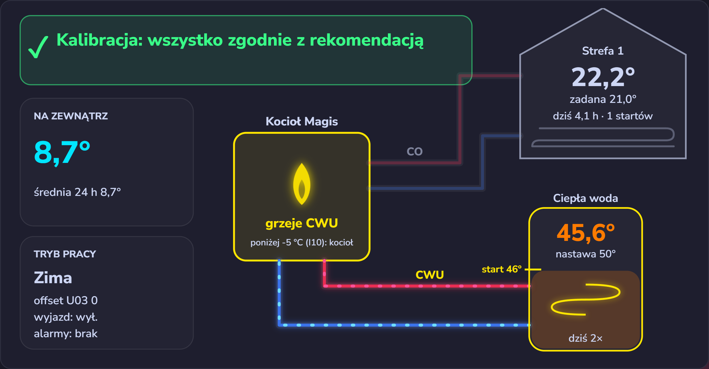

| | |
|---|---|
| 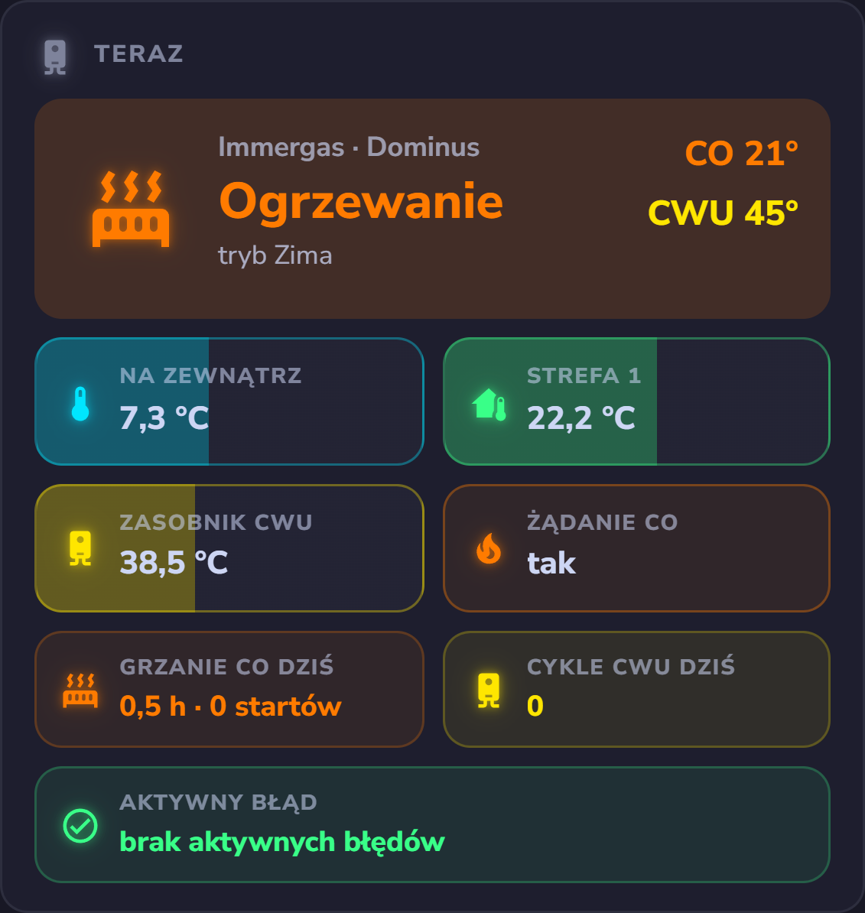 | 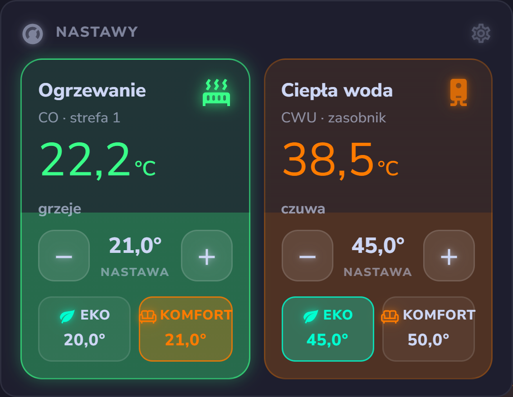 |
| 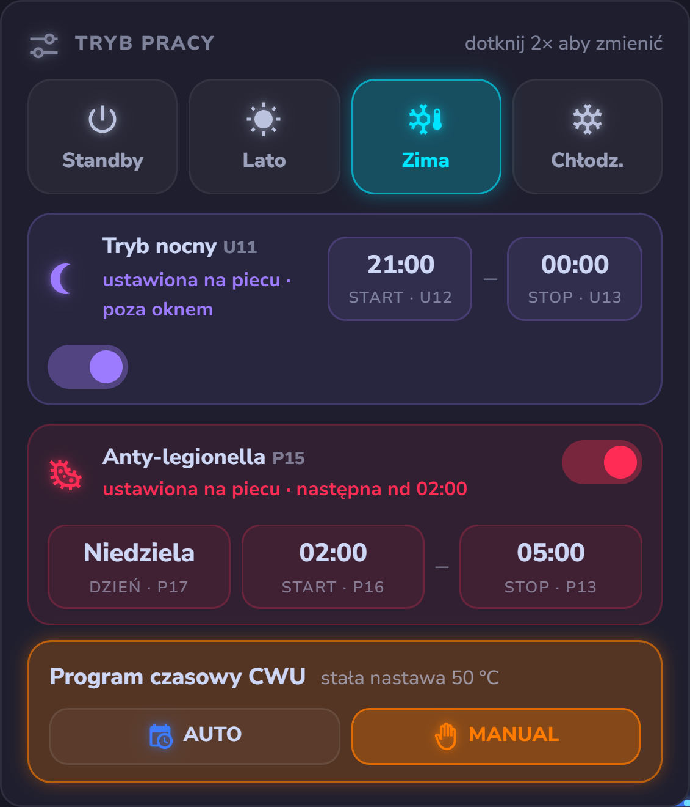 | 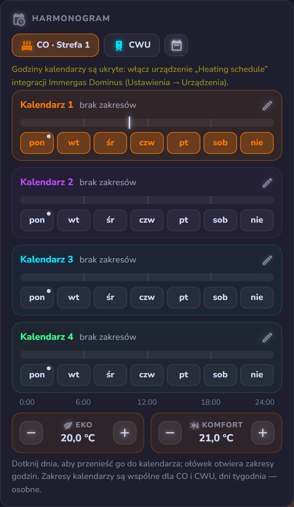 |
| 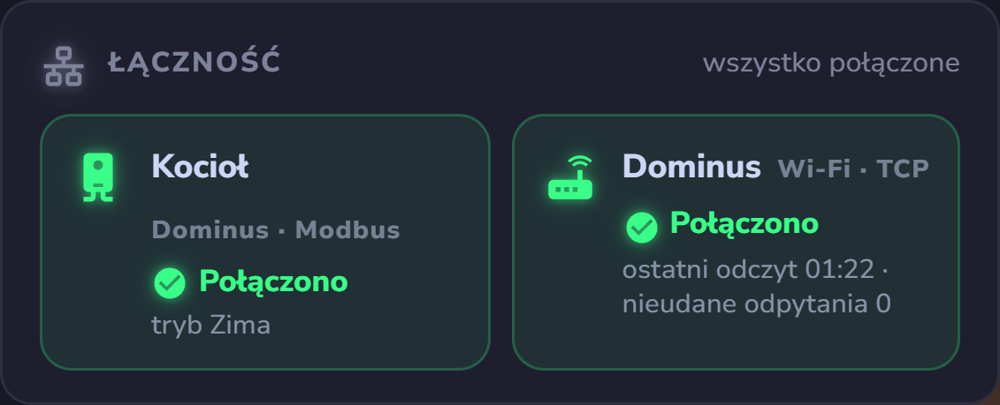 | 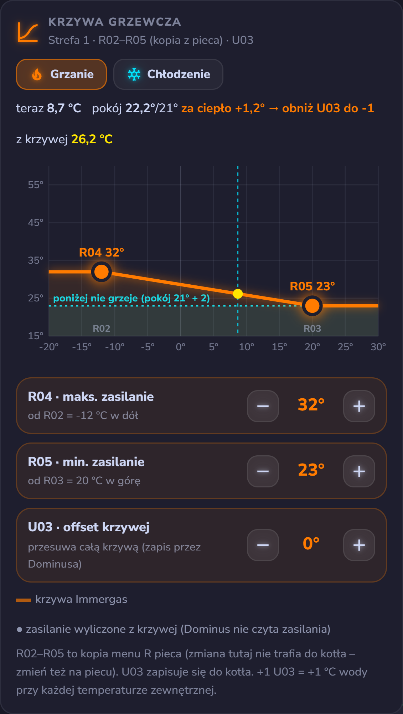 |
| 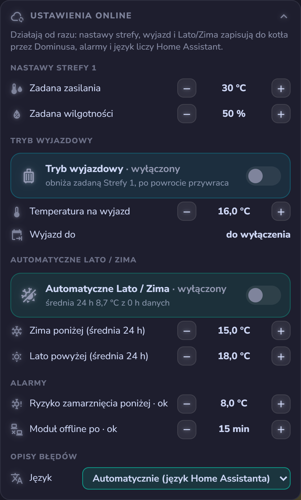 | 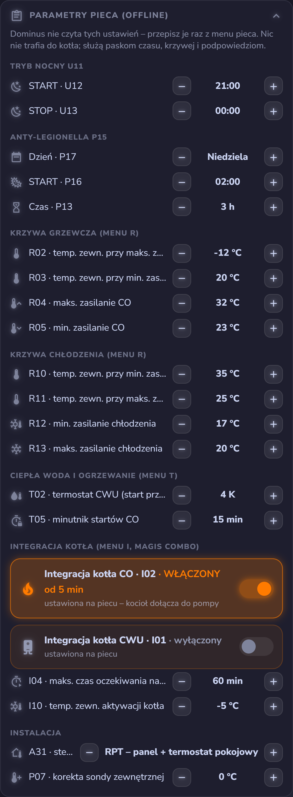 |

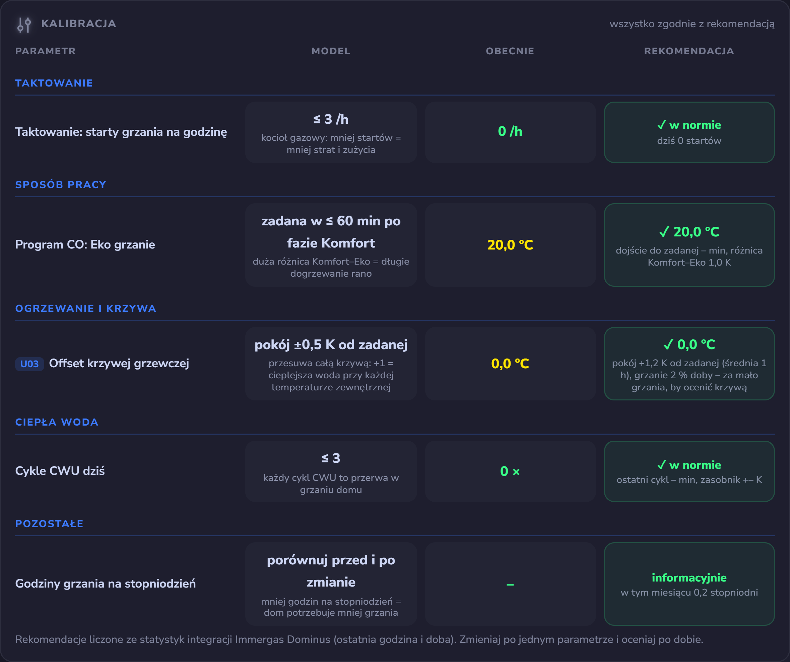

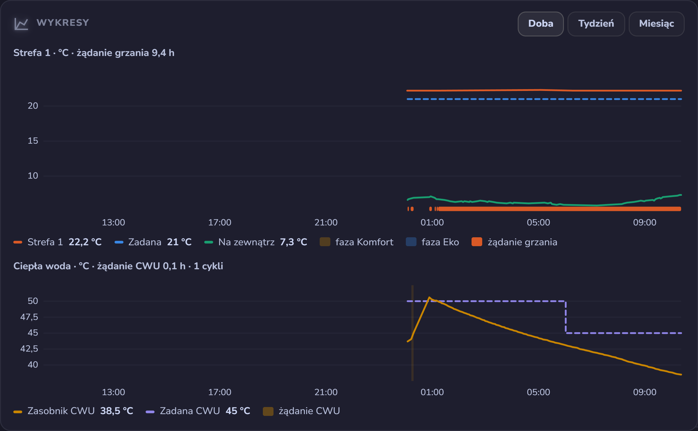

**OpenTherm bez pilota CAR V2 – Dominus jako regulator (1.6.0, eksperymentalne: zapisy regulatora niepotwierdzone jeszcze na kotle).** Gdy Dominus jest jedynym sterownikiem kotła
OpenTherm (CAR V2 odłączony, podłączona sonda pokojowa z kompletu Dominusa), integracja wystawia regulator Dominusa i
prowadzi w Home Assistant programy z CAR V2, bo moduł nie ma zegara:

- **Regulator** (parametry modułu, Data-ID 89, jak w oficjalnej aplikacji): krzywa grzewcza 1–9, offset CO ±15 °C,
  min. temperatura CO, bezwładność budynku 1–20, histereza pokojowa, modulacja, czujnik pokojowy, sonda zewnętrzna, co
  mierzy sonda (pokój / zewnątrz), ochrona przed zamarzaniem i jej temperatura; **zadana pokoju** (Data-ID 16),
  **temperatura pokoju** (Data-ID 24) i przycisk **resetu kotła**.
- **Programy w Home Assistant** (przywracane po restarcie): **program CO AUTO / MANUAL** – 4 kalendarze × 4 przedziały
  Komfort i kalendarz na każdy dzień (domyślnie program fabryczny CAR V2); AUTO zapisuje zadaną Komfort / Eko przy zmianie
  fazy, więc ręczna zmiana trzyma do następnej zmiany; w fazie Eko opcjonalnie **wyłączenie ogrzewania**; **CWU Komfort /
  Eko** wg kalendarza CWU; **wyjazd** (ogrzewanie wyłączone do daty); **automatyczne Lato / Zima** wg średniej 24 h;
  **anty-legionella** codziennie albo w poniedziałek o 02:00.
- **Tryb pracy** pokazuje teraz wybrany tryb (bity zezwoleń), a nie to, co kocioł akurat robi, z nazwami z aplikacji
  Standby / Lato / Zima (+ Tylko CO).

Z podłączonym CAR V2 steruje pilot – te programy zostaw wyłączone.

**Diagnostyka OpenTherm (1.6.1).** Żeby sprawdzić, co kocioł naprawdę obsługuje: **Skanuj Data-ID** (przycisk;
odczytuje raz każdy standardowy Data-ID, ok. minuty, odpytywanie stoi w tym czasie) → czujnik **Obsługiwane Data-ID**
pokazuje, co odpowiedziało, co jest nieobsługiwane i surowe wartości; **Ostatni zapis** odczytuje każdą zapisaną wartość
z powrotem – *Przyjęty* albo *Potwierdzony, nieprzyjęty*, gdy kocioł potwierdza zapis, ale zostawia swoją wartość;
**Bajt LB ramki statusu** wysyła 0xCA w każdej ramce Data-ID 0 – „poprawka Immergas” innych bramek OpenTherm, która
według zgłoszeń odblokowuje zapis Data-ID 1 / 57 w kotłach Immergas (eksperymentalne, domyślnie standard 0x00).
Data-ID, na które kocioł trzy razy z rzędu odpowie „nieobsługiwane”, są pomijane przez godzinę.

**Kotły OpenTherm (VICTRIX ZEUS / AVIO, STAR …).** W trybie OpenTherm ta sama strategia `custom:immergas-dominus`
pokazuje **te same karty** bez tych, dla których OpenTherm nie ma danych (harmonogramy, krzywa grzewcza, kalibracja /
statystyki, ustawienia, automatyzacje, łączność): **Schemat**, **Teraz** (zasilanie / powrót, CWU, zewnętrzna, modulacja,
ciśnienie, przepływ CWU, płomień, awaria), **Nastawy** (nastawa zasilania CO i CWU z −/+), **Tryb pracy** (Standby / Lato /
Zima / Tylko CO) i **Wykresy** (zasilanie / powrót / nastawa CO / zewnętrzna z płomieniem, CWU). Dopisz `opentherm: true` albo `opentherm: false` pod `strategy:`, żeby wymusić jeden albo
drugi widok.

Danych pompy ciepła (sprężarka, COP, zasilanie / powrót pompy, energia) nie da się odczytać przez Dominusa – do tego
służy hub.

## Statystyki i automatyki

Liczone w Home Assistancie z rejestrów, które integracja i tak czyta (status strefy `2010`, flagi stanu `2001`,
pokój `2011`, zadana `2015`, zewnętrzna `3002`, zasobnik CWU `3016`, tryb `2000`); niczego nie trzeba ustawiać.

- **Statystyki** (sensory): *Czas grzania CO dziś* i *Udział grzania CO (24 h)* (żądanie grzania Strefy 1), *Cykle CWU
  dziś*, *Czas ostatniego cyklu CWU* i *Przyrost zasobnika* (żądanie CWU), *Starty grzania CO na godzinę / dziś*,
  *Odchyłka pokoju od zadanej (1 h)* i *Czas dojścia do zadanej* (po podniesieniu zadanej albo Eko → Komfort),
  *Stopniodni dziś / w tym miesiącu* (baza 18 °C) i *Godziny grzania na stopniodzień* (w tym miesiącu). Liczniki dzienne
  i miesięczne przetrwają restart; okna 24 h i 60 min liczą się od nowa po restarcie.
- **Więcej statystyk (1.6.14)** (sensory, karta *Dziś · analiza*): *Czas w komforcie dziś* (pokój ±0,5 °C od zadanej),
  *Za zimno / Za ciepło dziś*, minimum / maksimum pokoju; *Tempo nagrzewania* i *Tempo stygnięcia pokoju* (°C/h z co
  najmniej 30 min jednego stanu), *Współczynnik strat budynku* (tempo stygnięcia ÷ (pokój − zewnątrz), 1/h) i
  *Sugerowana zmiana offsetu krzywej* (+1 / 0 / −1 °C ze średniej odchyłki w Komforcie z ostatnich 3-5 dni – tylko
  podpowiedź, nic nie jest zapisywane); *Faza Komfort / Eko dziś* z odchyłką pokoju w każdej i *Zmiany faz*; *Ciepło
  CWU* i *Ciepła woda zużyta dziś* (spadki zasobnika poza cyklami grzania × *Pojemność zasobnika CWU*, 200 L), *Straty
  postojowe zasobnika* (°C/h, 01-05 bez grzania), minimum zasobnika, *Średni cykl CWU*; *Stan pracy* jako jeden tekst;
  minimum / maksimum zewnętrznej dziś i *Średnia zewnętrzna 24 h*; *Dostępność modułu dziś* i *Przerwy w łączności*;
  Strefy 2 / 3: czas grzania, starty i odchyłka pokoju (razem z ich urządzeniami).
- **Tryb wyjazdowy** (domyślnie wyłączony): *Tryb wyjazdowy* ustawia zadaną Strefy 1 na *Temperaturę na wyjazd*
  (16 °C) i przywraca poprzednią po wyłączeniu albo o czasie *Wyjazd do*.
- **Automatyczne Lato / Zima** (domyślnie wyłączone): Zima, gdy średnia zewnętrzna z 24 h spadnie poniżej *Zima
  poniżej* (15 °C), Lato powyżej *Lato powyżej* (18 °C); potrzebuje 12 h danych, najwyżej jedna zmiana na godzinę, nigdy
  nie rusza trybów Standby i Chłodzenie.
- **Alerty**: *Ryzyko zamarznięcia* (pokój poniżej *Progu zamarzania*, 8 °C) i *Moduł Dominus offline* (brak odczytu
  przez *Offline po*, 15 min).
- **Programy kotła deklarowane przez ciebie** (niedostępne po TCP): *Funkcja nocna U11* ze startem i stopem (U12 / U13)
  oraz *Anty-legionella P15* z dniem, startem i czasem (P17 / P16 / P13). Włącz przełącznik, gdy program jest ustawiony
  na piecu; dashboard pokaże wtedy wiersz-przypomnienie i pasek czasu. Nic nie jest zapisywane do kotła.
- **Parametry przepisywane z menu pieca** (też niedostępne po TCP), wszystkie w karcie Ustawienia:
  - *Krzywa grzewcza* R02–R05 i *krzywa chłodzenia* R10–R13 – karta Krzywa rysuje je z offsetem U03 i zasilaniem
    wyliczonym dla bieżącej temperatury zewnętrznej; Kalibracja pokazuje, ile °C wody daje +1 U03.
  - *Termostat CWU T02* – cykl CWU startuje przy nastawie − T02 (karta Teraz, znacznik progu na zasobniku w diagramie).
  - *Minutnik startów CO T05* – pasek „Blokada startu CO” po zakończeniu żądania grzania; Kalibracja liczy z nim
    taktowanie.
  - *Integracja kotła* (Magis Combo): przełączniki I02 (CO) i I01 (CWU) oraz I04 (maks. czas oczekiwania) i I10
    (temperatura zewnętrzna aktywacji) – pasek „Dołączenie kotła” w czasie żądania grzania i podpowiedź poniżej I10.
  - *Sterowanie pokojowe A31* (RP / RPT / RT) – wyjaśnione na kafelku Panel Strefy 1; *korekta sondy zewnętrznej P07*
    – przypomnienie na diagramie, gdy jest różna od 0.

  **Wszystkie startują puste** po świeżej instalacji (zła wartość domyślna byłaby gorsza niż żadna). Przepisz każdą
  raz z menu pieca: pusta jest wyszarzona z napisem „nie ustawione – wpisz z pieca” i sugerowaną wartością; pierwsze
  dotknięcie −/+ zaczyna od tej sugestii. Każda funkcja (pasek, krzywa, podpowiedź) włącza się dopiero, gdy wszystkie
  jej wartości są ustawione.

## Baza wiedzy

Moduł Dominus mówi po lokalnym porcie TCP 2000 jednym z dwóch protokołów, zależnie od konfiguracji kotła:

| Protokół | Kotły | Co jest opisane |
|---|---|---|
| **Modbus** (główny) | Magis Combo / Pro-Combo V2, Magis Pro i inne konfiguracje `*_MBUS_*` | [docs/pdu-map.pl.md](https://github.com/jotuera/immergas-dominus/blob/main/docs/pdu-map.pl.md) – ramka, każde PDU z encją (urządzenie główne, strefy, programy czasowe), PDU znalezione, ale jeszcze nierozpoznane, czego nie da się odczytać po TCP |
| **OpenTherm** | VICTRIX ZEUS / AVIO, STAR … | [docs/opentherm.pl.md](https://github.com/jotuera/immergas-dominus/blob/main/docs/opentherm.pl.md) – ramka, każdy Data-ID z encją i odpowiedziami testowanych kotłów, specyfika Immergas, źródła |

**Pomóż zmapować swój kocioł (1.6.6).** **Skanuj PDU** (Modbus) albo **Skanuj Data-ID** (OpenTherm), wpisz **Model
kotła** i naciśnij **Zgłoś mapę PDU** / **Zgłoś mapę Data-ID**: powiadomienie zawiera link do **gotowego zgłoszenia na
GitHubie** (model, wersja integracji, mapa – bez adresu, MAC i hasła). Nic nie jest wysyłane automatycznie. Najcenniejsze
są skany innych modeli – każdy dokłada kolumnę do tabel powyżej.

## Obsługiwane modele

Wszystkie kotły, których moduł Dominus używa konfiguracji **`WFC01_IM_MBUS_MPROCOMBOV2`**,
mają tę samą mapę rejestrów i działają tak samo.

**Przetestowane — potwierdzone, że działają:**

- Magis Combo / Magis Pro-Combo V2
- Magis Pro
- Trio Hydro Hybrid 8 — zgłoszone przez @FrancescoC87 ([#3](https://github.com/jotuera/immergas-dominus/issues/3))

**Ta sama konfiguracja — powinny działać** (nietestowane pojedynczo; wg `CFGS` apki Dominus):

- Magis Hercules Pro
- Magis Hercules Pro Mini
- Magis Hercules Mini Hydro
- Trio Pack
- Trio Hydro

(Warianty `MPROCOMBOV2_8N2` = Magis Hercules i `MPROCOMBOV2_SYS` = gestore di sistema mają
tę samą mapę z drobną różnicą transmisji/adresowania.)

**Nie pokryte — inna konfiguracja Dominus / mapa rejestrów:**

- **VICTRIX ZEUS / AVIO**, STAR — protokół **OpenTherm** (zob. eksperymentalny tryb
  OpenTherm wyżej, [#2](https://github.com/jotuera/immergas-dominus/issues/2)).
- **TRIO** (`MBUS`), **SUPERIOR** (`SCP01`), **MAIOR / EXTRA** (`HDBC65`) — inne
  konfiguracje Modbus z własnymi mapami rejestrów.

Jeśli Twój kocioł używa configu `MPROCOMBOV2`, a nie ma go na liście, prawie na pewno
zadziała — otwórz zgłoszenie, żeby potwierdzić.

## Podłączenie

Moduł Dominus rozmawia z kotłem przez własne zaciski, a z Home Assistant przez Wi-Fi (lokalnie TCP 2000) – dla
integracji nic więcej nie podłączasz. Trzy typowe instalacje:

**Modbus – MAGIS PRO / COMBO V2** (Dominus na D+ / D−, opcjonalny termostat pokojowy ON / OFF na wejściu strefy 1):

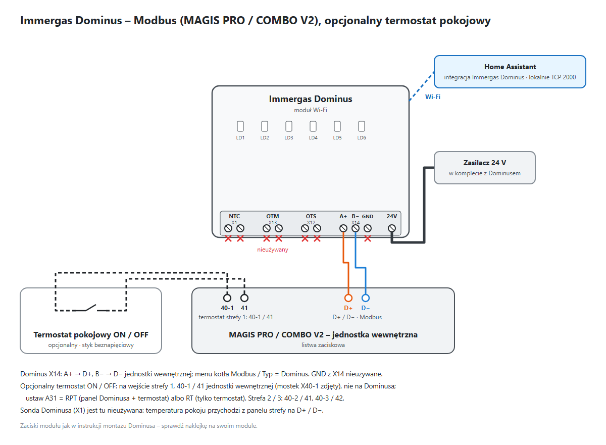

**OpenTherm z CAR V2** (pilot rządzi – włącz *Tylko odczyt (pilot rządzi)*):

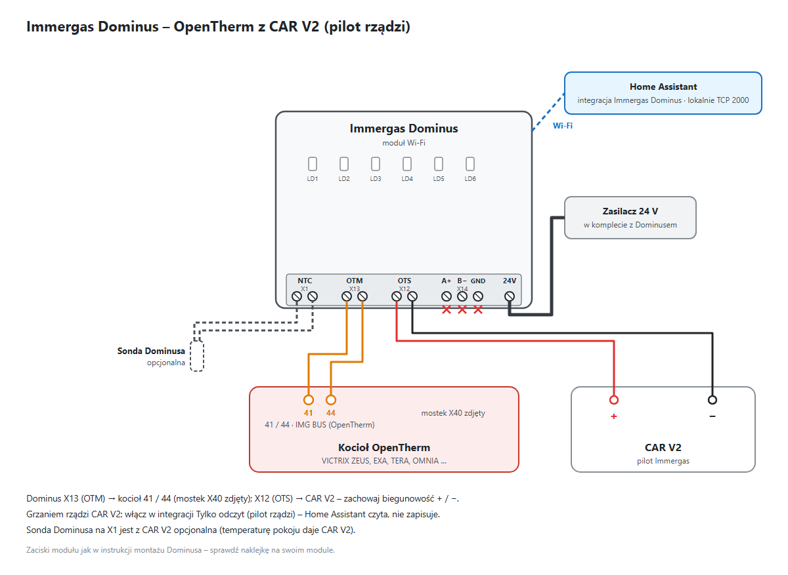

**OpenTherm bez CAR V2** (rządzi Home Assistant – zobacz [Zastąpienie CAR V2](https://github.com/jotuera/immergas-dominus/blob/main/docs/opentherm.pl.md#zastąpienie-car-v2)):

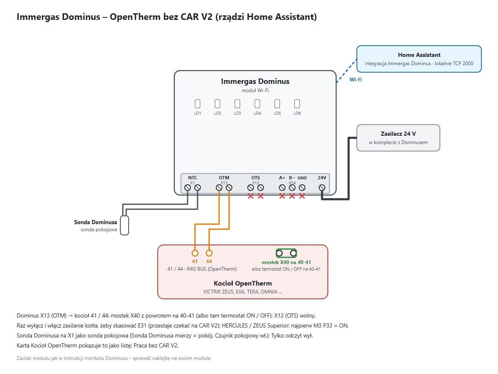

Zaciski modułu jak w instrukcji montażu Dominusa (X1 sonda NTC, X13 OTM kocioł, X12 OTS pilot, X14 A+ / B− / GND,
zasilanie 24 V) – sprawdź naklejkę na swoim module. Zaciski kotła dla modeli: [OpenTherm – kotły i zaciski](https://github.com/jotuera/immergas-dominus/blob/main/docs/opentherm.pl.md#kotły-i-zaciski).

## Instalacja

### HACS (niestandardowe repozytorium)

1. HACS → *Integracje* → ⋮ → *Niestandardowe repozytoria*.
2. Dodaj `https://github.com/jotuera/immergas-dominus`, kategoria *Integration*.
3. Zainstaluj **Immergas Dominus**, zrestartuj Home Assistant.
4. *Ustawienia → Urządzenia i usługi → Dodaj integrację → Immergas Dominus*.

### Ręcznie

Skopiuj `custom_components/immergas_dominus` do katalogu `config/custom_components/` w
Home Assistant, zrestartuj HA, a następnie dodaj integrację jak wyżej.

Pierwsza sesja lokalna TCP może zostać odrzucona przez moduł Dominus (np. tuż po użyciu
aplikacji mobilnej); integracja i tak utworzy encje, a wartości pojawią się, gdy moduł
przyjmie sesję.

## Uwagi

- Opisy błędów to własne teksty projektu (11 języków), wspólne z IMMERGAS Modbus BMS NASA OpenTherm HUB;
  kody błędów i ich znaczenie odpowiadają dokumentacji kotła.
- Rejestry potwierdzone tylko na magistrali D+/D- (harmonogram, flagi błędów) są
  sprawdzone krzyżowo, ale na innych modelach mogą wymagać weryfikacji przez TCP AUTH.

## Historia zmian

### 1.6.20

- **Schemat OpenTherm – temperatura ogrzewania:** OpenTherm ma jeden odczyt zasilania, czyli wodę w kotle (Data-ID 25).
  Podczas grzania zasobnika i przez 3 minuty po nim domek pokazuje ostatnią wartość z pracy CO, z dopiskiem *przed CWU*.
- **Schemat OpenTherm – limit CO:** przy sondzie zewnętrznej parametr 17 jest opisany jako *maks.*: to górny limit
  zasilania, a nie faktyczny cel.
- Frontend: karty huba 0.89.3.

### 1.6.19

- **Jasny motyw:** na jasnym motywie Home Assistanta karty używają przyciemnionych kolorów, delikatniejszych podświetleń
  i wyraźniejszych opisów, więc wszystko jest czytelne na białym tle. Wygląd ciemny się nie zmienia.
- Dzień programu anty-legionelli mieści się w kafelku.
- Frontend: karty huba 0.89.2.

### 1.6.18

- **Karty w 9 językach:** przetłumaczone 998 tekstów kart, które wyświetlały się jeszcze po angielsku (cs, de, es, fr, hu, it,
  nl, pt, sk). Tłumaczenie maszynowe, poprawki mile widziane.
- **Dashboard OpenTherm:** *Łączność* przeniesiona pod *Wykresy*, cztery kafelki w jednym rzędzie.
- **Skuteczność optymalizacji:** każdy okres liczy tylko godziny z kompletem statystyk, więc licznik z dłuższą historią nie
  zawyża już kolumny „przed”.
- Frontend: karty huba 0.88.0.

### 1.6.17

- **OpenTherm – nadzór CO:** czy kocioł naprawdę podjął żądanie CO. *Nadzór CO* nazywa stan (potwierdzone, priorytet CWU,
  zasilanie blisko nastawy, awaria, brak żądania, oczekiwanie), *CO: kocioł nie reaguje* włącza się po ustawionym czasie
  (domyślnie 15 min). Żądanie jest wnioskowane z bitu CO, nastawy wysyłanej i temperatury pokoju; przy fizycznym
  termostacie na zaciskach kotła nie jest widoczne. Tylko diagnostyka, nic nie jest zapisywane.
- Frontend: karty huba 0.87.0.

### 1.6.16

- **Tłumaczenia:** 68 nazw encji dodanych w 1.6.x (statystyki Dziś · analiza, wartości liczone OpenTherm, cena gazu,
  pojemność zasobnika CWU) jest teraz we wszystkich 11 językach – wcześniej poza angielskim i polskim były po angielsku.
- **Schematy podłączenia** w README: Modbus (MAGIS PRO / COMBO V2, opcjonalny termostat pokojowy), OpenTherm z CAR V2
  i bez CAR V2.
- Frontend: karty huba 0.86.0 (huby ESP OpenTherm / kotłów gazowych / MAGIS M znajdowane w każdym języku, nazwy encji
  bez „/”). CHANGELOG, SECURITY i CONTRIBUTING po polsku; zaktualizowany opis w HACS.

### 1.6.15

- **OpenTherm – Praca bez CAR V2** (karta *Ustawienia online*) pasuje do kotła pogodowego: przy regulatorze Dominusa
  na sondzie zewnętrznej, własnej krzywej kotła (ZEUS Superior / HERCULES P66 w *Parametrach kotła (offline)*) albo
  temperaturze zewnętrznej bez temperatury pokoju wiersze pokojowe (*Sonda Dominusa w pokoju*, *Regulacja pokojowa
  (AMB)*) są informacyjne – *niepotrzebne – regulacja pogodowa*.
- Podpowiedź pracy bez pilota podaje zaciski IMG BUS **41 / 44** w ZEUS Superior 26 / 32 (42 / 43 to zaciski Super
  CAR), potwierdzone na ZEUS Superior 26 2 ErP. Frontend: karty huba 0.84.2.

### 1.6.14

- Karta **Dziś · analiza** (oba tryby) – wartości liczone w Home Assistant, nic nie trafia do kotła.
- **Modbus – więcej statystyk** (`stats_extra`): komfort dziś (czas w komforcie, za zimno / za ciepło, min / maks
  pokoju), budynek (tempo nagrzewania / stygnięcia, współczynnik strat, podpowiedź zmiany przesunięcia krzywej – tylko
  wskazówka), fazy Komfort / Eko, CWU (ciepło i woda zużyte dziś z nowej **pojemności zasobnika CWU**, straty postojowe,
  minimum zasobnika, średni cykl), stan pracy, min / maks / średnia 24 h temperatury zewnętrznej, dostępność modułu
  i przerwy łączności, strefy 2 / 3.
- **OpenTherm – wartości liczone** (`ot_computed`): delta T, nastawa sterująca i odchyłka, kondensacja, moc palnika,
  gaz / ciepło dziś i licznik gazu z **ceną gazu**, taktowanie, pobory i cykle CWU, stan pracy, spadek ciśnienia /
  ostrzeżenie o wycieku, prąd płomienia, odchyłka wentylatora, odchyłka pokoju, stopniodni.
- Frontend: karty huba 0.84.0 – *Kalibracja* i *Automatyki* także w tablicy OpenTherm, krzywa pogodowa OpenTherm
  i mapa Data-ID.

### 1.6.13

- **Typ urządzenia** (Modbus): *Pompa ciepła* albo *Kocioł gazowy* (VICTRIX ZEUS Superior 25-35, HERCULES, EXTRA z nowej
  platformy). Kocioł gazowy usuwa *Chłodzenie* z trybu pracy i termostatów, a tablica ukrywa wartości pompy ciepła
  (Komfort / Eko i krzywa chłodzenia, wilgotność, funkcja nocna U11, integracja kotła I01–I10). [Mapa
  Modbus](docs/pdu-map.pl.md) ma sekcję *Kotły gazowe* – raport skanu PDU potwierdza mapę dla kotła gazowego.
  Frontend: karty huba 0.59.0.

### 1.6.12

- **Zabezpieczenie emulowanego termostatu** (OpenTherm): gdy encja źródłowa przez 60 minut nie poda świeżej, poprawnej
  temperatury, Data-ID 24 przestaje być wysyłany, a kafel **Termostat** robi się czerwony (*Brak źródła temperatury*);
  wysyłanie wraca samo. Nowe atrybuty `source_lost` i `source_age_min` w *Termostat pokojowy*.
- Baza wiedzy: **Kotły i zaciski** w [OpenTherm](docs/opentherm.pl.md) – gdzie podłącza się urządzenie OpenTherm w
  VICTRIX EXA / ZEUS / TERA i dlaczego każdy master OpenTherm nadpisuje nastawę CWU.
- **Rodziny menu kotłów** z instrukcji instalatora Immergas: *Profil menu kotła* ma teraz VICTRIX ZEUS 25 / EXA 28 /
  OMNIA, **TERA V2 / V3**, **EXA 24 X / NIKE 24 ECO**, ZEUS Superior 26 / 32 i **HERCULES Condensing / Solar 26** – karta
  *Parametry pieca (offline)* pokazuje kody danej rodziny. Nowe deklarowane wartości: TERA P7 protokół pilota, HERCULES
  P57 sterowanie pompą i M3 P33 *CO bez działającego pilota* (także na liście *Praca bez CAR V2*). Nowa platforma
  (ZEUS Superior 25-35, HERCULES 25 / 35, EXTRA) opisana jako kocioł Modbus.
- **Start z wyprzedzeniem** (OpenTherm, program CO AUTO): Komfort zaczyna się wcześniej wg nauczonego tempa nagrzewania
  (°C/h), domyślnie najwyżej 120 min. **Otwarte okno**: czujniki okien / drzwi obniżają nastawę pokoju do 7 °C, gdy
  któryś jest otwarty – oba w karcie *Tryb pracy*. Frontend: karty huba 0.58.0.

### 1.6.11

- **Diagnostyka OpenTherm ze skanu VICTRIX ZEUS Superior** (domyślnie wyłączona): zdalne parametry kotła (Data-ID 6 –
  czy kocioł udostępnia zdalnie nastawę CWU / maks. CO), dzień i godzina kotła (Data-ID 20) oraz temperatury zasobnika
  i kolektora solarnego oraz CWU 2 (Data-ID 29 / 30 / 32, puste bez czujnika).

### 1.6.10

- **OpenTherm: profile menu kotła** – *Profil menu kotła* (VICTRIX ZEUS 25 / VICTRIX ZEUS Superior / ogólny, albo
  zgadywanie z modelu kotła) wybiera kody, zakresy i jednostki karty **Parametry pieca (offline)**. Superior: krzywa
  pogodowa P66/A–D, P68–P71, moce jako obroty wentylatora (P57 / P62 / P64 / P65), pompa P55 / P67, P76 i liczniki M1
  (godziny pracy, zapłony palnika) – zob. [profile menu](https://github.com/jotuera/immergas-dominus/blob/main/docs/opentherm.pl.md).
- **OpenTherm: termostat emulowany** oceniany po odczycie zwrotnym Data-ID 24 (*działa* / *moduł nie przyjmuje*); wybór
  i encja źródła przeniesione do Parametrów pieca (offline); kafel Termostat na czerwono, gdy brak temperatury pokoju,
  a potrzebuje jej termostat emulowany albo regulacja wg pokoju (AMB).
- Karty 0.56.1: nazwy trybu OpenTherm (Standby / Lato / Zima / Tylko CO) na wszystkich kartach; Łączność Dominusa
  w dwóch kolumnach (kocioł + termostat, Dominus + panel strefy 1 / CAR V2); ikona w README.

### 1.6.9

- **Dashboard OpenTherm** (karty 0.54.0): nowa karta **Kocioł OpenTherm** (moc, min. modulacja, zakresy CO / CWU, typ
  CWU, spaliny, wentylator, starty palnika, flagi i historia błędów, reset kotła, przełącznik tylko do odczytu) i karta
  **Mapa Data-ID** (skan, parametry kotła, zgłoszenie); przy *Tylko odczyt* kontrolki pokazują kłódkę zamiast zapisywać;
  wynik ostatniego zapisu pod nastawami; kafelki ciśnienia / przepływu CWU znikają, gdy kocioł ich nie podaje; spaliny na
  wykresie kotła, wykres modulacji palnika i godziny pracy palnika na dobę.
- **OpenTherm: starty palnika dziś / w ostatniej godzinie i czas pracy palnika dziś** (liczone z płomienia co cykl
  odczytu – bardzo krótkie zapłony mogą umknąć) oraz **opis błędu kotła** (kod z Data-ID 5, np. E31).
- Dokumentacja: baza wiedzy w `docs/` – Modbus po TCP (każde PDU z encją) i OpenTherm (tabela Data-ID przeniesiona z
  README).
- **Łączność OpenTherm** (karty 0.54.1): Dominus, kocioł i kafel **pilota CAR V2** zamiast panelu strefy 1 – E31 (utrata
  pilota), jest temperatura pokoju, włączone *Tylko odczyt* – z przełącznikiem blokującym zapis z HA.
- **OpenTherm: programy HA są wstrzymane, gdy steruje pilot** (*Tylko odczyt* włączone): program CO / CWU,
  antylegionella, urlop i automatyczne Lato / Zima nie zapisują i nie da się ich włączyć; karty pokazują je szare
  z kłódką (karty 0.54.2). **Antylegionella** nigdy nie żąda więcej niż maksimum CWU kotła (Data-ID 48, 60 °C
  w VICTRIX ZEUS) – powyżej cel nie był osiągany, a cykl trwał 3 h.
- **OpenTherm: reszta funkcji CAR V2**, żeby pilota dało się zdjąć – w fazie Eko **obniżenie zadanej zasilania**
  (RIDOTT ON), **samouczenie** offsetu CO (AUTO A), **przypomnienie o przeglądzie** (MANUTZ), urlop jako **Stand-by**
  (CO i CWU wył., jak CAR V2) albo Lato, CWU Eko do minimum kotła, antylegionella trzymana 20 min, reset kotła
  ograniczony do 5 prób na godzinę; lista kontrolna *Praca bez CAR V2* w karcie Kocioł OpenTherm (karty 0.54.3).
- **OpenTherm: menu kotła deklarowane offline** (t0 / t1, t2, t4–t7, P0–P2, P6, P7, A3–A5) z podpowiedziami – np. t5
  przy taktowaniu palnika; karta **Parametry pieca (offline)** na dashboardzie OpenTherm (karty 0.55.2).
- **Modbus: kafel Termostat** w karcie Łączność wg deklarowanego sposobu sterowania A31 (RP / RPT / RT, Parametry pieca
  offline); temperatury pokoju zapisanej przez TCP moduł nie przyjmuje (test), robi to emulowany panel strefy huba
  (karty 0.55.4).
- **OpenTherm: termostat pokojowy** – brak / fizyczny (zaciski 40-41) / **emulowany**: temperatura encji HA trafia do
  modułu jako Data-ID 24 (eksperymentalne); kafel Termostat w karcie Łączność (karty 0.55.3).
  Zob. [Zastąpienie CAR V2](https://github.com/jotuera/immergas-dominus/blob/main/docs/opentherm.pl.md#zastąpienie-car-v2).

### 1.6.8

- **OpenTherm: Tylko odczyt (steruje pilot)** – przełącznik blokujący każdy zapis z Home Assistant (kontrolki, programy,
  reset); odczyty i wyświetlane nastawy zostają. Dla kotła sterowanego CAR V2 / Super Amico: wartość raz zapisana z HA
  Dominus zapamiętuje i nadpisuje nią pilota aż do odłączenia zasilania modułu (#2).

### 1.6.7

- **OpenTherm: Skanuj Data-ID czyta też własne parametry kotła** (TSP, Data-ID 10 / 11 – 42 w VICTRIX ZEUS 25 ErP) i
  **historię błędów** (Data-ID 12 / 13), gdy kocioł je podaje: atrybuty *boiler_parameters* / *fault_history* czujnika
  *Obsługiwane Data-ID* i w **Zgłoś mapę Data-ID**.

### 1.6.6

- **OpenTherm: obroty wentylatora** (Data-ID 35), **prąd płomienia** (36) i **historia błędów** (12 / 13), domyślnie
  wyłączone; **Ostatni zapis** bez fałszywego *Potwierdzony, nieprzyjęty* (tolerancja 0,5 °C i ponowny odczyt).

- **Skaner PDU** (tryb Modbus): skan zakresu PDU przez TCP Dominusa, mapa w czujniku i **Zgłoś mapę PDU** – link do
  gotowego zgłoszenia na GitHubie z modelem kotła (nic nie jest wysyłane automatycznie).
- **OpenTherm: Zgłoś mapę Data-ID** – ten sam raport dla skanu Data-ID.

### 1.6.5

- **Home Assistant 2026.11:** termostaty używają nowych właściwości temperatury `native_*` (stare są przestarzałe i
  przestaną działać w 2027.11); starsze wersje Home Assistant działają dalej.
- README: bezwzględne linki do obrazków (w sklepie HACS brakowało zrzutów kart).

### 1.6.4

- **Stabilne wydanie linii 1.6.** Potwierdzone na kotłach OpenTherm (VICTRIX ZEUS, #2): dashboard OpenTherm i jego
  automatyczne wykrywanie, odczyty, skaner Data-ID. Regulator Dominusa i programy w Home Assistant (1.6.0) zostają
  eksperymentalne, dopóki tester nie potwierdzi zapisów.
- **Flagi błędów OpenTherm** (Data-ID 5): niskie ciśnienie wody, błąd gazu / płomienia, błąd ciśnienia powietrza,
  przegrzanie wody, żądanie serwisu – np. alarm niskiego ciśnienia na kotłach, które nie podają ciśnienia (#2).

### 1.6.3 (pre-release)

- **Dashboard OpenTherm wykrywany automatycznie** także wtedy, gdy Home Assistant trzyma jeszcze encje z wcześniejszej
  konfiguracji Modbus (osierocone wpisy rejestru nie są już brane pod uwagę); `opentherm: true` nie jest już potrzebne (#2).
  Karty 0.52.4.
- Karty 0.52.3: T05 maks. 15 min.

### 1.6.2 (pre-release)

- **OpenTherm:** temperatura spalin (Data-ID 33), moc maks. i modulacja min. kotła (Data-ID 15); suwaki nastaw CWU i CO
  trzymają się limitów podawanych przez kocioł (Data-ID 48 / 49) (#2).
- Karty 0.52.2.

### 1.6.1 (pre-release)

- **Diagnostyka OpenTherm:** skaner Data-ID (przycisk + czujnik z listą obsługiwanych / nieobsługiwanych), odczyt
  zwrotny każdego zapisu (*Przyjęty* / *Potwierdzony, nieprzyjęty*), opcjonalny bajt 0xCA w ramkach Data-ID 0
  („poprawka Immergas” innych bramek OpenTherm, eksperymentalne), nieobsługiwane Data-ID pomijane przez godzinę (#2).

### 1.6.0 (pre-release, funkcje OpenTherm do przetestowania)

- **OpenTherm – regulator Dominusa** (parametry modułu Data-ID 89 jak w oficjalnej aplikacji): krzywa grzewcza, offset CO,
  min. temperatura CO, bezwładność budynku, histereza pokojowa, modulacja, czujnik pokojowy / zewnętrzny, rola sondy,
  ochrona przed zamarzaniem; zadana pokoju (Data-ID 16), temperatura pokoju (Data-ID 24), przycisk resetu kotła (#2).
- **OpenTherm – programy w Home Assistant** dla Dominusa bez pilota CAR V2: program CO AUTO / MANUAL z 4 kalendarzami i
  kalendarzem na każdy dzień, w fazie Eko zadana albo wyłączenie CO, CWU Komfort / Eko wg kalendarza CWU, wyjazd,
  automatyczne Lato / Zima, anty-legionella. Wszystko domyślnie wyłączone.
- **OpenTherm – tryb pracy** pokazuje wybrany tryb (bity zezwoleń), a nie bieżącą pracę, z nazwami z aplikacji
  Standby / Lato / Zima (+ Tylko CO).
- **Dashboard OpenTherm** na kartach Dominusa (schemat, teraz, nastawy, tryb, ustawienia, harmonogram, wykresy); karty 0.52.0.

### 1.5.8

- **Okrojony dashboard dla kotłów OpenTherm** (VICTRIX ZEUS / AVIO, STAR …): strategia `custom:immergas-dominus`
  rozpoznaje tryb OpenTherm i buduje Teraz / Sterowanie / Historię ze standardowych kart Home Assistant;
  `opentherm: true` / `false` wymusza widok (#2).
- Karty dashboardu 0.51.5.

### 1.5.7

- **Program czasowy CO strefy 1 AUTO / MANUAL** (nowy select, jak w oficjalnej aplikacji): MANUAL ustawia wszystkie dni na
  kalendarz całodobowy (stała nastawa 24 h), AUTO przywraca wcześniejsze przypisanie dni i nigdy nie zostawia dnia na
  kalendarzu całodobowym. Panel ustawiony na MANUAL (bit statusu strefy) też jest pokazywany jako MANUAL.
- Przerwany zapis harmonogramu jest ponawiany, więc przełączenie AUTO / MANUAL nie zatrzymuje się w połowie.
- Karty dashboardu 0.51.4 (rekomendacja I09 zachowana przy CWU z kotła, wiersz trybu harmonogramu).
- README: zachowanie pilota CAR V2 (Amico V2) z kotłami OpenTherm; zapis nastawy CO potwierdzony na VICTRIX ZEUS 25 ErP (#2).

### 1.5.6

- OpenTherm (VICTRIX): **nastawa CO** jest odczytywana i zapisywana jako parametr modułu 17 (Data-ID 89, HB = 17,
  LB = °C), dokładnie jak w oficjalnej aplikacji; **nastawa CWU** jest zapisywana w pełnych stopniach (HB = °C, LB = 0) (#2).

### 1.5.5

- OpenTherm (VICTRIX): surowe bajty każdego zapisu i odpowiedzi, której nie da się odczytać, trafiają do logu debug –
  żeby ustalić, czego moduł oczekuje przy zapisie nastaw (#2).

### 1.5.4

- **Home Assistant 2026.11:** encje podurządzeń (strefy, harmonogram) znowu się dodają – urządzenie nadrzędne jest
  wskazane przez id, a godziny harmonogramu mają poprawny opis encji.
- Przełącznik **Powiadomienia o alarmach**: ryzyko zamarznięcia, moduł offline albo błąd kotła tworzą powiadomienie
  w Home Assistant, usuwane po ustaniu alarmu (domyślnie włączony).
- Temperatury zewnętrzna, pokoju i zasobnika CWU mają statystyki długoterminowe.
- Karty 0.51.0: karta **Automatyzacje** dla wbudowanych automatyk i alarmów (Lato / Zima, wyjazd, harmonogram CWU,
  powiadomienia, zamarznięcie, moduł offline, błąd kotła) oraz **skuteczność optymalizacji** w Kalibracji (godziny
  grzania na stopniodzień, starty, odchyłka pokoju; opcjonalnie `energy_entity` / `gas_entity`); rodzaj posadzki
  i powierzchnia ogrzewana w ustawieniach online.

### 1.5.3

- **OpenTherm (VICTRIX i inne kotły bez Modbusa):** sesja jest zwalniana po każdym cyklu odczytów, więc oficjalna
  aplikacja Dominus może się w tym czasie połączyć (moduł obsługuje jednego klienta TCP naraz). Nieudany zapis zgłasza
  teraz prawdziwą przyczynę zamiast AssertionError.
- Nowe parametry do wpisania raz: **rodzaj posadzki** (cementowa / anhydrytowa / system suchy) i **powierzchnia ogrzewana**.
- Karty 0.50.1: Kalibracja uwzględnia rodzaj posadzki (limit podłogi, obniżki, harmonogram CO, I04), pokazuje straty
  ciepła budynku (W/K i W/m², gdy zbierze się dość dni grzania), karta krzywej pomija zasilanie podczas grzania CWU,
  statystyki cykli pomijają przerwy po restarcie, wiersze taktowania mają przycisk Ustaw (R05 / T05).

### 1.5.2

- Karty 0.47.0: wszystkie teksty dashboardu w 11 językach.
- Karty ładują się tylko raz: gdy karty IMMERGAS Modbus BMS NASA OpenTherm HUB są zainstalowane jako zasób Lovelace,
  integracja używa ich zamiast własnej (być może starszej) kopii.

### 1.5.1

- Kalibracja: rekomendacje z parametrów przepisanych z pieca – T02, T05, U11, P15 / P13, I04, I10, A31 i P07;
  Ustawienia podzielone na online i offline; zadana zasilania i wilgotności Strefy 1 w ustawieniach online.

### 1.5.0

- **Więcej deklarowanych parametrów pieca**: krzywa grzewcza R02–R05, krzywa chłodzenia R10–R13, termostat CWU T02,
  minutnik startów CO T05, integracja kotła I01 / I02 / I04 / I10, sterowanie pokojowe A31 i korekta sondy P07 –
  korzystają z nich karta Krzywa (nowa na dashboardzie), paski karty Teraz (blokada startu CO, dołączenie kotła, próg
  startu CWU), podpowiedzi na diagramie i teksty Kalibracji.
- **Deklarowane wartości startują puste** (także wartości funkcji nocnej i anty-legionelli z 1.4.0 przy nowej
  instalacji) i pokazują sugestię, dopóki nie przepiszesz prawdziwej z pieca. Wpisane już wartości zostają.

### 1.4.0

- **Deklarowane programy kotła**: funkcja nocna U11 (start / stop) i anty-legionella P15 (dzień, start, czas) jako
  przełączniki i ustawienia trzymane w Home Assistancie – karta Tryb pracy pokazuje je jak w hubie, a karta Teraz
  pokazuje ich paski czasu, gdy przełącznik jest włączony. Nic nie jest zapisywane do kotła.

### 1.3.0

- **Statystyki i automatyki** liczone w Home Assistancie: czas i udział grzania CO, cykle CWU, starty grzania, odchyłka
  pokoju i czas dojścia do zadanej, stopniodni i godziny grzania na stopniodzień; tryb wyjazdowy, automatyczne Lato /
  Zima (oba domyślnie wyłączone), alerty zamarzania i braku łączności z modułem. Nazwy w 11 językach.

### 1.2.0

- Wybór **Język opisów błędów** (konfiguracja): opis błędu w języku Home Assistanta (domyślnie) albo w jednym
  z 11 języków, niezależnie od języka Home Assistanta.
- Dashboard: karta **Ustawienia** z językiem błędów, nastawy Strefy 1 w karcie Tryb pracy (Komfort / Eko chłodzenia
  lub grzania, zadana zasilania i wilgotności), karta Harmonogram zawsze widoczna (z podpowiedzią, gdy godziny
  kalendarzy są wyłączone).

### 1.1.0

- **Dashboard**: integracja udostępnia karty Immergas Hub i ładuje je w Home Assistancie; nowy dashboard ze
  `strategy: {type: custom:immergas-dominus}` pokazuje karty Teraz, Nastawy, Tryb pracy, Harmonogram i Łączność.

### 1.0.0

- **Nowa licencja**: PolyForm Noncommercial 1.0.0 (bezpłatnie do użytku osobistego i innego niekomercyjnego).
- **Własne opisy błędów kotła** (`2100`), 113 kodów w 11 językach, napisane dla tego projektu, wspólne
  z [IMMERGAS Modbus BMS NASA OpenTherm HUB](https://github.com/jotuera/immergas-modbus-bms-nasa-opentherm-hub). Kod 0 pokazuje
  „Brak błędów”.
- **Zapis już nie odskakuje**: po potwierdzonym zapisie moduł potrafi jeszcze przez odczyt lub dwa podawać starą
  wartość; przez 30 s taki odczyt nie cofa zapisanej wartości.
- **Presety Komfort / Eko** w termostatach stref: preset pokazuje fazę programu strefy (`2010`), wybór ustawia
  zadaną strefy na jej nastawę Komfort / Eko (`2210`/`2211`, chłodzenie `2214`/`2215`).
- **Diagnostyka połączenia**: `Ostatni udany odczyt` i `Nieudane odpytania` (atrybut `missing_in_last_poll`).
- Wcześniejsze wersje rozwojowe (0.2–0.6) zbudowały wszystko z rozdziału *Funkcje*: tryb pracy, strefy 1–3,
  harmonogramy CO i CWU, CWU Komfort / Eko, raportowanie błędów, eksperymentalny tryb OpenTherm, 11 języków.

## Projekt siostrzany

**Chcesz pełny obraz pompy ciepła?** [**IMMERGAS Modbus BMS NASA OpenTherm HUB**](https://github.com/jotuera/immergas-modbus-bms-nasa-opentherm-hub)
to jedno urządzenie ESPHome (M5Stack AtomS3) na wszystkich trzech magistralach Magis Pro / Magis Combo V2 –
D+/D- Modbus, T-/T+ BMS i F1/F2 Samsung NASA. Dokłada to, czego moduł Dominus nie niesie: pompę ciepła i sprężarkę,
COP, gaz, CWU z pompy i pełną kalibrację. Karty dashboardu tej integracji pochodzą z huba.

## Wsparcie

Jeśli integracja ci się przydaje, rozważ wsparcie – postaw mi kawę. Dziękuję!

<a href="https://buymeacoffee.com/jotuera"></a>

## Zasoby graficzne

Dołączone zasoby brandowe Home Assistant znajdują się w
`custom_components/immergas_dominus/brand/`. Ikona to oryginalna grafika projektu
(czerwone tło, biały termostat i symbole bezprzewodowe) i nie kopiuje grafik Immergas/Dominus.

## Licencja

[PolyForm Noncommercial 1.0.0](https://github.com/jotuera/immergas-dominus/blob/main/LICENSE) © JoTu: bezpłatnie do użytku osobistego i innego niekomercyjnego – w domu,
dla własnego kotła, do nauki i badań. **Użycie komercyjne** (instalatorzy, sprzedawcy, wbudowanie w płatny produkt)
wymaga osobnej licencji – skontaktuj się przez GitHub. Zobacz też [CONTRIBUTING](https://github.com/jotuera/immergas-dominus/blob/main/CONTRIBUTING.md).
Niezwiązane z Immergas ani nierekomendowane przez Immergas.
